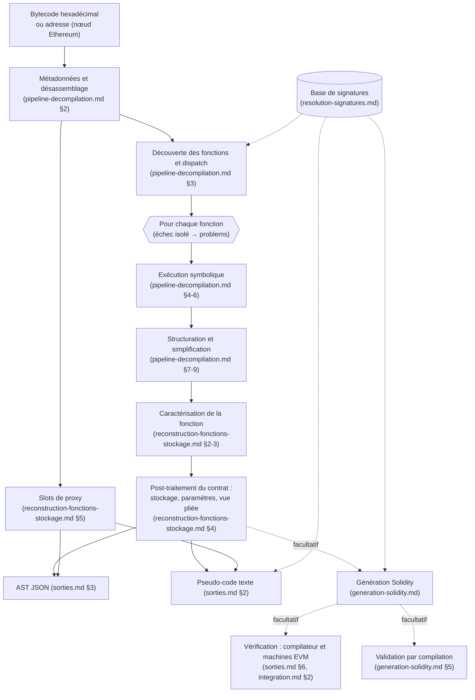

# Architecture et interfaces d'appel de Scobelix

Scobelix est un décompilateur EVM générique, dérivé du décompilateur Panoramix : à partir du bytecode runtime d'un contrat (fourni directement ou récupéré à partir de son adresse), il produit un pseudo-code lisible, un AST JSON structuré (fonctions, traces, structure du stockage, slots de proxy reconnus, métadonnées du compilateur, analyse du dispatch) et, sur demande, une reconstruction Solidity, éventuellement validée par un compilateur externe et vérifiée contre le bytecode d'origine. Ce document (préfixe `ARCH`) énonce les exigences qui portent sur la nature du système, ses capacités, l'enchaînement global de son pipeline, sa configuration, ses dépendances, sa politique de robustesse, ainsi que le contrat exact de ses deux façades d'invocation : la commande `scobelix` et l'interface de programmation Python.

Le détail de chaque étape du pipeline est spécifié ailleurs : désassemblage, découverte des fonctions, exécution symbolique, structuration et simplification dans [pipeline-decompilation.md](pipeline-decompilation.md) ; caractérisation des fonctions, inférence des paramètres, structure du stockage et slots de proxy dans [reconstruction-fonctions-stockage.md](reconstruction-fonctions-stockage.md) ; nommage des fonctions, événements et erreurs par la base de signatures dans [resolution-signatures.md](resolution-signatures.md) ; reconstruction Solidity, vérification par génération et validation dans [generation-solidity.md](generation-solidity.md). Le format exact de tout ce qui est produit, rapport de vérification compris, est dans [sorties.md](sorties.md), les échanges avec l'extérieur (nœud Ethereum, compilateur, machines EVM, système de fichiers, distribution, intégration continue) dans [integration.md](integration.md), et le format des données de signatures dans [../specification-parametrage/parametrage-signatures.md](../specification-parametrage/parametrage-signatures.md). Voir [README.md](../README.md) pour la table des matières du répertoire `docs/`.

Chaque exigence est identifiée par un code FR-ARCH-NN. Sauf mention contraire (« DEVRAIT », « PEUT », « NE DOIT PAS »), une exigence est obligatoire (« DOIT »).

## 1. Vue d'ensemble et nature du système

Scobelix n'est pas un service : c'est un outil de ligne de commande et une bibliothèque importable qui s'exécutent dans le processus de l'utilisateur, du début à la fin d'une décompilation.

- **FR-ARCH-01** : Le système DOIT être utilisable à la fois comme bibliothèque Python importable par un programme tiers et comme commande en ligne, sans exposer de serveur HTTP, de socket d'écoute, de file de messages ni de base de données externe.
- **FR-ARCH-02** : Le système DOIT exécuter une décompilation, une génération, une validation ou une vérification de manière synchrone, dans le processus et sur le fil d'exécution de l'appelant, et ne rendre la main qu'une fois toutes les sorties demandées produites ; seul le compilateur Solidity, binaire externe, est lancé comme processus fils, le temps d'une compilation ou de l'identification de sa version (voir [integration.md](integration.md), section 2).
- **FR-ARCH-03** : Le système NE DOIT effectuer aucun accès réseau, à deux exceptions près : la récupération du code d'un contrat lorsque l'entrée est une adresse (voir [integration.md](integration.md), section 1), et le téléchargement d'une version officielle du compilateur Solidity lorsque l'appelant l'a explicitement autorisé (voir section 4 et [integration.md](integration.md), section 2) ; en particulier, le nommage des fonctions, des événements et des erreurs NE DOIT consulter aucun service en ligne (voir [resolution-signatures.md](resolution-signatures.md)).
- **FR-ARCH-04** : Le système DOIT traiter toute séquence d'octets fournie à la décompilation comme du bytecode runtime EVM, dont le bloc final de métadonnées du compilateur, lorsqu'il est reconnu, est lu comme une donnée et non désassemblé (voir [pipeline-decompilation.md](pipeline-decompilation.md), section 2) ; la décompilation NE DOIT accepter ni code source ni ABI en entrée, et elle ne distingue pas un bytecode de création (constructeur suivi du code déployé), qui serait décompilé tel quel comme s'il s'agissait du code déployé.
- **FR-ARCH-05** : Le système DOIT conserver le style de pseudo-code de l'outil dont il est dérivé ; en conséquence, la sortie texte commence par l'en-tête hérité `# Palkeoramix decompiler. ` et non par le nom du système (format exact dans [sorties.md](sorties.md), section 2).
- **FR-ARCH-06** : Une décompilation DOIT produire, en une seule passe, un résultat composé de neuf parties : le pseudo-code texte, le désassemblage, l'AST JSON, la liste des indices de slots de proxy reconnus, le bytecode complet, les métadonnées du compilateur, l'analyse du dispatch, les fonctions décompilées en mémoire et l'état du budget de temps global sous lequel elle s'est exécutée (absent sans budget global, voir section 4).

## 2. Capacités (points d'entrée fonctionnels)

- **FR-ARCH-07** : Le système DOIT fournir une capacité de décompilation à partir d'un bytecode exprimé en hexadécimal, avec ou sans préfixe `0x` ou `0X`, les espaces et retours à la ligne qui l'entourent étant ignorés (l'interface Python accepte aussi une suite d'octets), qui produit le résultat décrit en FR-ARCH-06 ; une entrée qui contient un caractère non hexadécimal (espace intérieur compris), qui compte un nombre impair de chiffres ou qui n'est pas une chaîne DOIT être refusée, avant toute analyse, par une erreur d'entrée invalide qui en donne la raison.
- **FR-ARCH-08** : Le système DOIT fournir une capacité de décompilation à partir d'une adresse de contrat, qui récupère le code déployé auprès d'un nœud Ethereum (voir [integration.md](integration.md), section 1) puis produit exactement le même résultat que la décompilation du bytecode obtenu.
- **FR-ARCH-09** : Ces deux capacités DOIVENT accepter un filtre optionnel par préfixe de nom de fonction : seules les fonctions découvertes (fonctions de sélecteur, fonction de repli `_fallback(?)` et fonction de réception `_receive(?)`) dont le nom affiché commence par ce préfixe sont décompilées ; les autres sont ignorées silencieusement, sans figurer dans la liste des échecs.
- **FR-ARCH-10** : Le système DOIT fournir une capacité de génération Solidity qui prend en entrée un résultat de décompilation et en lit les fonctions en mémoire, le bytecode, les métadonnées et l'analyse du dispatch ; un résultat réduit à son AST JSON, ou cet AST seul, DOIT être accepté dans un mode dégradé signalé par des avertissements, où le code est relu depuis les traces de l'AST, laissé sous sa forme exacte et non vérifiable. La capacité produit un code source, un niveau de confiance par fonction, une liste d'avertissements, une table par fonction et, sur demande, le rapport de la vérification du code produit (voir [generation-solidity.md](generation-solidity.md), sections 1 et 7).
- **FR-ARCH-11** : Le système DOIT fournir une capacité de validation d'un code Solidity par un compilateur externe, dont le résultat est l'un des statuts `valid`, `invalid` ou `skipped` ; un code que le pipeline par défaut du compilateur refuse faute de place sur la pile et que son pipeline IR accepte est `valid`, avec l'indication de cette restriction (voir [generation-solidity.md](generation-solidity.md), section 5).
- **FR-ARCH-12** : Le système DOIT fournir une capacité de vérification qui compare un code Solidity au bytecode runtime d'origine aux niveaux L0 (compilation), L1 (même interface externe), L2 (même disposition du stockage), L3 (comportement équivalent, observé par exécution différentielle fonction par fonction) et L4 (bytecode identique aux métadonnées et immuables près), et retourne le rapport de [sorties.md](sorties.md), section 6 ; elle est utilisable seule ou par la génération.
- **FR-ARCH-13** : Le système DOIT fournir, en dehors du pipeline de décompilation, un outil satellite de régénération du fichier de signatures locales à partir de fichiers ABI (voir [resolution-signatures.md](resolution-signatures.md), section 5).
- **FR-ARCH-14** : Lorsque le bytecode fourni est vide, ou réduit au seul bloc de métadonnées du compilateur, le système DOIT produire, sans lever d'erreur, le résultat « aucun code » : un texte réduit à un message unique, sans l'en-tête de FR-ARCH-05 (format dans [sorties.md](sorties.md), section 2.1), un AST vide `{}`, un désassemblage vide, une liste d'indices de proxy vide, ni analyse du dispatch ni fonction en mémoire, le bytecode et les métadonnées éventuelles restant renseignés, ainsi que, sous un budget de temps global, l'état de ce budget (non épuisé, aucune fonction laissée de côté).

## 3. Pipeline de décompilation (vue d'ensemble)

Chaque étape est spécifiée dans le document indiqué sur le diagramme ; cette section ne fixe que leur enchaînement et leurs interactions.

- **FR-ARCH-15** : Le système DOIT enchaîner, dans cet ordre : la lecture du bloc de métadonnées et le désassemblage du code qui le précède ; une passe légère d'exécution symbolique de découverte des fonctions, suivie de l'analyse du dispatch qui en fixe les points d'entrée (fonctions de sélecteur, de repli et de réception) ; pour chaque fonction retenue, l'exécution symbolique complète, la structuration des boucles et la simplification, puis la caractérisation de la fonction ; ensuite, au niveau du contrat entier, la reconstruction de la structure du stockage, le remplacement des accès aux paramètres par leurs noms, la préparation de la vue d'affichage ; enfin la détection des slots de proxy, la sérialisation de l'AST JSON et le rendu du texte.
- **FR-ARCH-16** : Le système DOIT décompiler chaque fonction indépendamment des autres : une exception ou un dépassement du budget par fonction (voir section 4) DOIT ajouter la fonction à la liste des échecs (`problems`), être journalisé (voir [sorties.md](sorties.md), section 7), et NE DOIT PAS interrompre la décompilation des autres fonctions ni le post-traitement du contrat.
- **FR-ARCH-17** : Le système DOIT effectuer la reconstruction de la structure du stockage une seule fois pour l'ensemble des fonctions décompilées, après leur décompilation, et non fonction par fonction (voir [reconstruction-fonctions-stockage.md](reconstruction-fonctions-stockage.md), section 4).
- **FR-ARCH-18** : Le système DOIT détecter les slots de proxy à partir du seul désassemblage brut, indépendamment des traces symboliques et du résultat de leur décompilation (voir [reconstruction-fonctions-stockage.md](reconstruction-fonctions-stockage.md), section 5).
- **FR-ARCH-19** : Le système DOIT produire l'AST JSON et le texte dans la même passe, à partir des mêmes fonctions post-traitées ; la répartition entre trace non pliée (AST) et vue pliée (texte) est spécifiée dans [pipeline-decompilation.md](pipeline-decompilation.md), section 10.

## 4. Configuration

La configuration se fait exclusivement par variables d'environnement et par les options de la commande (section 7) ; aucun fichier de configuration n'est lu.

| Variable | Défaut | Rôle |
|---|---|---|
| `PANORAMIX_FUNCTION_TIMEOUT` | 720 | budget total, en secondes, de la décompilation d'une fonction |
| `PANORAMIX_VM_RUN_TIMEOUT` | 600 | budget, en secondes, de l'exécution symbolique d'une fonction |
| `PANORAMIX_WHILES_TIMEOUT` | 600 | limite, en secondes, de la simplification d'une fonction |
| `PANORAMIX_LOADER_TIMEOUT` | 120 | budget, en secondes, de la passe de découverte des fonctions |
| `PANORAMIX_MAX_NODE_COUNT` | 500000 | nombre maximal de nœuds d'exploration par exécution symbolique |
| `SCOBELIX_TIME_BUDGET` | (aucun : pas de budget global) | budget de temps global, en secondes, de la décompilation de chaque entrée de la commande, lorsque l'option `--time-budget` est absente |
| `WEB3_PROVIDER_URI` | (aucun) | point d'accès du nœud Ethereum, lu par la bibliothèque d'accès Ethereum |
| `SCOBELIX_SIGDB` | (aucun : fichier du répertoire de cache utilisateur) | fichier de la base de signatures |
| `SCOBELIX_SOLC_DIR` | (aucun) | répertoire de compilateurs Solidity consulté en premier, et destination des téléchargements |
| `SCOBELIX_ALLOW_SOLC_DOWNLOAD` | (refus) | autorisation de télécharger un compilateur Solidity manquant |
| `SCOBELIX_ABI_ROOTS` | (vide) | répertoires parcourus par l'outil de régénération des signatures |
| `SCOBELIX_SIGS_OUT` | fichier de signatures locales embarqué | fichier écrit par l'outil de régénération des signatures |

- **FR-ARCH-20** : Le système DOIT lire les variables `PANORAMIX_*` une seule fois, au chargement du système dans le processus ; une modification ultérieure de l'environnement du processus NE DOIT PAS avoir d'effet sur les décompilations suivantes. La variable `SCOBELIX_TIME_BUDGET`, qui borne elle aussi le temps d'une décompilation, fait exception : la commande la lit à chaque invocation, au moment d'analyser ses arguments, et l'interface Python ne la lit jamais (FR-ARCH-78).
- **FR-ARCH-21** : Le système DOIT borner la décompilation complète d'une fonction (exécution symbolique, structuration et simplification) par le budget `PANORAMIX_FUNCTION_TIMEOUT`, par défaut 720 secondes, ramené sous un budget global au temps que celui-ci laisse encore aux fonctions lorsque ce temps est plus court (FR-ARCH-79) ; son dépassement interrompt la fonction et la range parmi les échecs (FR-ARCH-16).
- **FR-ARCH-22** : Le système DOIT borner l'exécution symbolique d'une fonction par le budget `PANORAMIX_VM_RUN_TIMEOUT`, par défaut 600 secondes. Sous un budget global, cette limite DOIT être la part du budget de la fonction (FR-ARCH-21) que l'exécution symbolique reçoit sans budget global, c'est-à-dire le rapport de `PANORAMIX_VM_RUN_TIMEOUT` à `PANORAMIX_FUNCTION_TIMEOUT` (600/720 par défaut, la totalité au plus), ou 75 % de ce budget lorsque l'une de ces deux valeurs est nulle, sans dépasser `PANORAMIX_VM_RUN_TIMEOUT` lorsque celle-ci n'est pas nulle : l'exécution symbolique s'arrête ainsi avant l'interruption de la fonction, dont elle garde la trace partielle. L'effet d'un dépassement est spécifié dans [pipeline-decompilation.md](pipeline-decompilation.md), section 4.
- **FR-ARCH-23** : Le système DOIT arrêter la simplification d'une fonction au plus tard à la plus proche de deux échéances : `PANORAMIX_WHILES_TIMEOUT` secondes (par défaut 600) après le début de la simplification, et 75 % du budget `PANORAMIX_FUNCTION_TIMEOUT` après le début de la décompilation de la fonction, ce budget étant, sous un budget global, celui que FR-ARCH-21 ramène (détail des échéances dans [pipeline-decompilation.md](pipeline-decompilation.md), section 8) ; une fonction ainsi arrêtée garde une trace exacte mais moins simplifiée, NE DOIT PAS être rangée parmi les échecs, et DOIT être marquée comme arrêtée à sa limite de temps dans le texte, l'AST et le journal ([sorties.md](sorties.md), sections 2.1, 3 et 7).
- **FR-ARCH-24** : Le système DOIT borner la passe de découverte des fonctions par le budget `PANORAMIX_LOADER_TIMEOUT`, par défaut 120 secondes, ramené sous un budget global au temps que celui-ci laisse aux fonctions lorsque ce temps est plus court (FR-ARCH-79).
- **FR-ARCH-25** : Une valeur nulle de l'un de ces quatre budgets DOIT désactiver la limite de temps correspondante ; une valeur nulle de `PANORAMIX_FUNCTION_TIMEOUT` supprime aussi l'échéance de 75 % de FR-ARCH-23. Sous un budget global, une valeur nulle de `PANORAMIX_LOADER_TIMEOUT` ou de `PANORAMIX_FUNCTION_TIMEOUT` laisse au contraire l'étape correspondante bornée par le seul temps restant (FR-ARCH-79), l'échéance de 75 % s'appliquant alors au budget de la fonction ainsi fixé, et une valeur nulle de `PANORAMIX_VM_RUN_TIMEOUT` donne à l'exécution symbolique 75 % du budget de la fonction (FR-ARCH-22).
- **FR-ARCH-78** : Le système DOIT accepter un budget de temps global facultatif, en secondes, pour la décompilation d'une entrée tout entière : il borne la découverte des fonctions et les fonctions, réserve une part de son temps aux étapes qui les suivent (FR-ARCH-79) et, dans la commande, borne la génération et la validation Solidity (FR-ARCH-80). La commande le prend dans l'option `--time-budget`, sinon dans la variable `SCOBELIX_TIME_BUDGET` (absente, vide ou réduite à des espaces : pas de budget global), et l'interface Python dans un paramètre nommé de ses deux fonctions de décompilation (FR-ARCH-62). La valeur DOIT être un nombre de secondes strictement positif et fini (écritures décimale et scientifique admises) ; toute autre valeur (zéro, nombre négatif, infini, valeur non numérique, valeur vide de l'option et, dans l'interface Python, valeur booléenne) DOIT être refusée : dans la commande, par une erreur de l'analyseur d'arguments et un code de sortie 2, le message nommant la variable lorsque la valeur vient d'elle ; dans l'interface Python, par une erreur de valeur levée avant la découverte des fonctions. Une valeur aussi grande soit-elle DOIT être acceptée : chaque délai que le budget fait armer sur le signal d'horloge (FR-ARCH-33) est plafonné à 10⁹ secondes (environ 31 ans), ce qui revient à ne fixer aucune limite. Chaque entrée d'une liste séparée par des virgules (FR-ARCH-50) reçoit le budget entier, qui court à partir du début de sa décompilation proprement dite, une fois l'entrée lue et validée et, en mode adresse, le code récupéré. Sans budget global, la décompilation, la génération et la validation se déroulent exactement comme sous les seuls budgets de FR-ARCH-21 à FR-ARCH-25.
- **FR-ARCH-79** : Sous un budget global, le système DOIT réserver aux étapes qui suivent la décompilation des fonctions (caractérisation, reconstruction du stockage, préparation de l'affichage, AST et texte), qui n'ont pas de limite de temps propre, 10 % du budget et au moins 5 secondes, réserve qu'il DOIT accroître de la moitié de la durée de chaque fonction dont la simplification s'est arrêtée à sa limite de temps (FR-ARCH-23), la trace moins simplifiée d'une telle fonction allongeant ces étapes ; il NE DOIT accorder à la découverte et aux fonctions que le temps qui reste avant cette réserve : la passe de découverte est bornée par la plus courte de sa propre limite et de ce temps, et ne peut être omise (sans temps restant, elle s'arrête à son premier contrôle du temps) ; chaque fonction atteinte reçoit pour budget le plus court de `PANORAMIX_FUNCTION_TIMEOUT` et de ce temps, son exécution symbolique la part de ce budget que fixe FR-ARCH-22, et sa simplification l'échéance de 75 % de ce budget, de sorte qu'une fonction dont la simplification est coupée reste exacte et marquée comme arrêtée à sa limite de temps, et non en échec (FR-ARCH-23). Une fonction atteinte lorsqu'il reste moins d'une seconde de ce temps NE DOIT PAS être décompilée : elle DOIT être rangée parmi les échecs (`problems`) et dans la liste des fonctions laissées de côté, avec un avertissement dans le journal ([sorties.md](sorties.md), section 7), et il en va de même de toutes les suivantes ; un budget de 6 secondes ou moins ne laisse ainsi de temps à aucune fonction. Le budget DOIT être marqué épuisé dès qu'il a écourté le travail : fonction laissée de côté ; fonction interrompue par un budget de fonction qu'il avait ramené, ou dont la simplification s'est arrêtée à l'échéance d'un tel budget (un budget de fonction nul, que le temps restant remplace, étant toujours tenu pour ramené) ; et, dans la commande (FR-ARCH-80), génération Solidity sautée ou interrompue, boucle de vérification arrêtée à la limite qu'il lui avait ramenée, exécution du compilateur coupée par le temps qu'il laissait à la validation, ou validation sautée.
- **FR-ARCH-80** : Sous un budget global, la commande DOIT borner la génération Solidity (option `--solidity`) par ce qui reste du budget, diminué d'une réserve de 2 secondes pour l'écriture de la sortie : lorsque ce temps est inférieur à 2 secondes, la génération NE DOIT PAS être tentée ; sinon, une génération qui le dépasse DOIT être interrompue ; dans les deux cas, le budget est marqué épuisé et la sortie le signale ([sorties.md](sorties.md), sections 4 et 5). Avec `--verify`, la durée totale de la boucle de vérification DOIT être la plus courte de sa propre limite (la valeur de `--verify-timeout`, 300 secondes par défaut) et du temps accordé à la génération, diminué du plus grand de son quart et de 2 secondes : la boucle s'arrête ainsi d'elle-même avant l'interruption de la génération, qui écrit alors sous leur forme exacte les fonctions que la boucle n'a pas acceptées ([generation-solidity.md](generation-solidity.md), section 7). Avec `--validate-solidity`, la validation DOIT recevoir, pour toutes ses exécutions du compilateur ensemble, ce qui reste alors du budget, diminué de la réserve de sortie, chaque exécution restant bornée par son délai maximal (30 secondes) : la seconde compilation par le pipeline IR ([generation-solidity.md](generation-solidity.md), section 5) ne reçoit que ce que la première a laissé, et n'est pas lancée s'il ne reste rien. Lorsqu'il ne reste rien avant la validation, celle-ci NE DOIT PAS être lancée : son statut est `skipped`, avec l'avertissement `time budget exhausted before the Solidity validation`, et le budget est marqué épuisé. L'interruption de la génération repose sur le signal d'horloge de FR-ARCH-33 : lorsque la commande ne s'exécute pas sur le fil d'exécution principal du processus, la génération n'est pas bornée et un avertissement le signale.
- **FR-ARCH-81** : Sous un budget global, la commande DOIT produire la sortie principale de chaque entrée, éventuellement partielle (fonctions laissées de côté, génération Solidity sautée ou interrompue), même lorsque le budget est épuisé, à une exception près : avec `--solidity` sans `--combined-json`, une génération sautée ou interrompue ne laisse rien à imprimer (FR-ARCH-61). Cette sortie n'est écrite qu'une fois l'entrée entièrement traitée, de sorte qu'un processus arrêté de l'extérieur avant ce moment n'en écrit rien. Le budget NE DOIT PAS être tenu pour une borne de la durée du processus : il ne couvre ni le démarrage du processus, ni la lecture de l'entrée, ni, en mode adresse, la récupération du code ; la première construction de la base de signatures, lorsqu'elle survient pendant la décompilation, compte dans le temps écoulé mais n'est pas interrompue ; les étapes qui suivent les fonctions peuvent dépasser leur réserve (FR-ARCH-79). Un appelant qui impose un délai à la commande DOIT donc lui accorder le budget augmenté d'une marge pour ces étapes ; cette marge dépend du contrat et du budget, et ne peut être seulement proportionnelle au budget, ces étapes pouvant prendre plusieurs dizaines de secondes sur un grand contrat quel que soit le budget.
- **FR-ARCH-26** : Le système DOIT limiter chaque exécution symbolique à `PANORAMIX_MAX_NODE_COUNT` nœuds d'exploration, par défaut 500 000 ; cette valeur fixe aussi le seuil de l'élagage décrit dans [pipeline-decompilation.md](pipeline-decompilation.md), section 4. Contrairement aux budgets de temps, une valeur nulle NE DOIT PAS être interprétée comme « sans limite » : elle arrête l'exploration dès la fin de sa première itération et active l'élagage en permanence.
- **FR-ARCH-27** : Une valeur non entière de l'une des cinq variables `PANORAMIX_*` DOIT provoquer une erreur dès le chargement des capacités de décompilation (donc au démarrage de la commande), avant toute décompilation ; le chargement des capacités de génération, de validation et de vérification par un programme Python qui les importe seules n'y est pas sensible.
- **FR-ARCH-28** : Le système NE DOIT PAS interpréter lui-même `WEB3_PROVIDER_URI` : cette variable est laissée à la bibliothèque d'accès Ethereum, qui l'utilise pour choisir le nœud interrogé en mode adresse (voir [integration.md](integration.md), section 1).
- **FR-ARCH-29** : Les variables `SCOBELIX_ABI_ROOTS` et `SCOBELIX_SIGS_OUT` DOIVENT n'être lues que par l'outil de régénération des signatures et n'avoir aucun effet sur une décompilation (voir [resolution-signatures.md](resolution-signatures.md), section 5).
- **FR-ARCH-30** : Les variables `SCOBELIX_SIGDB`, `SCOBELIX_SOLC_DIR` et `SCOBELIX_ALLOW_SOLC_DOWNLOAD` DOIVENT être lues au moment où elles servent (première ouverture de la base de signatures dans le processus, recherche ou téléchargement d'un compilateur), et non au chargement du système : `SCOBELIX_SIGDB` désigne le fichier de la base de signatures à la place de l'emplacement par défaut ([integration.md](integration.md), section 3) ; `SCOBELIX_SOLC_DIR` désigne un répertoire de compilateurs consulté en premier et la destination des téléchargements ([integration.md](integration.md), section 2) ; `SCOBELIX_ALLOW_SOLC_DOWNLOAD` autorise le téléchargement d'un compilateur manquant lorsqu'elle vaut `1`, `true`, `yes` ou `on` (casse et espaces de bord ignorés), un choix explicite de l'appelant l'emportant sur elle (l'interface Python peut autoriser ou refuser, la commande ne peut qu'autoriser, par `--allow-solc-download`).
- **FR-ARCH-31** : Les paramètres suivants DOIVENT être des constantes non configurables du système :

  | Paramètre | Valeur | Spécifié dans |
  |---|---|---|
  | Seuil de « grande trace » (lignes de premier niveau) | 2 000 | [pipeline-decompilation.md](pipeline-decompilation.md), section 8 |
  | Nombre maximal de passes de simplification | 40 (20 au-delà du seuil) | [pipeline-decompilation.md](pipeline-decompilation.md), section 8 |
  | Nettoyage mémoire sauté au-delà de | 2 000 lignes | [pipeline-decompilation.md](pipeline-decompilation.md), section 8 |
  | Itérations d'exploration | 20 × 200 | [pipeline-decompilation.md](pipeline-decompilation.md), section 4 |
  | Seuil d'élagage | 60 % du nombre maximal de nœuds | [pipeline-decompilation.md](pipeline-decompilation.md), section 4 |
  | Part du budget par fonction ouverte à la simplification | 75 % | FR-ARCH-23 |
  | Réserve du budget global pour les étapes qui suivent les fonctions | 10 % du budget, au moins 5 secondes, plus la moitié de la durée de chaque fonction arrêtée à sa limite de temps | FR-ARCH-79 |
  | Temps minimal d'une fonction sous un budget global | 1 seconde | FR-ARCH-79 |
  | Délai maximal armé sur le signal d'horloge sous un budget global | 10⁹ secondes | FR-ARCH-78 |
  | Réserve de sortie et temps minimal de la génération Solidity sous un budget global | 2 secondes chacun | FR-ARCH-80 |
  | Part du temps de la génération refusée à la boucle de vérification sous un budget global | 25 %, au moins 2 secondes | FR-ARCH-80 |
  | Délai maximal de chaque exécution du compilateur par la validation | 30 secondes | [generation-solidity.md](generation-solidity.md), section 5 |
  | Version minimale du pragma du Solidity généré | 0.8.2, relevée par les constructions employées | [generation-solidity.md](generation-solidity.md), section 2 |
  | Version de compilateur visée en dernier recours | 0.8.19 | [generation-solidity.md](generation-solidity.md), section 2 |
  | Limites par défaut de la boucle de vérification | 300 secondes, 20 exécutions | [generation-solidity.md](generation-solidity.md), section 7 |
  | Budget par défaut d'une exécution de vérification | 300 appels par fonction, 30 séquences de 12 appels | [sorties.md](sorties.md), section 6 |
  | Taille du cache des sorties du compilateur | 64 Mio par processus | section 6 |
  | Nom du fichier de la base de signatures | `sigdb-<schéma>-<empreinte des données>.sqlite` | [integration.md](integration.md), section 3 |

*Note contextuelle : deux préfixes de variables d'environnement coexistent. Les budgets par étape et le nombre de nœuds gardent le préfixe `PANORAMIX_` hérité de l'outil amont, tandis que les variables propres au système (budget de temps global, base de signatures, compilateur, outil de régénération) portent le préfixe `SCOBELIX_`. Les noms sont conservés tels quels pour la compatibilité.*

## 5. Dépendances fonctionnelles

- **FR-ARCH-32** : Le système DOIT fonctionner avec un interpréteur Python de version supérieure ou égale à 3.9 et strictement inférieure à 4.
- **FR-ARCH-33** : Le système DOIT mettre en œuvre le budget par fonction, ainsi que l'interruption de la génération Solidity de la commande par le budget global (FR-ARCH-80), au moyen d'un signal d'horloge du système d'exploitation ; il exige donc une plateforme disposant de ce mécanisme (les plateformes Windows ne sont pas supportées) et un appel depuis le fil d'exécution principal du processus (voir FR-ARCH-71). Le budget global lui-même est une échéance consultée entre les étapes, sans signal propre.
- **FR-ARCH-34** : Le système DOIT s'appuyer sur une bibliothèque d'accès Ethereum figée à la version bêta 6.0.0-beta.8 pour la récupération du code d'une adresse (et la mise au format checksum de celle-ci) et pour le calcul des sélecteurs par l'outil de régénération des signatures ; cette bibliothèque NE DOIT être chargée ni par la décompilation d'un bytecode, ni par la génération, la validation ou la vérification. Le calcul keccak-256 de la base de signatures s'appuie sur la bibliothèque de hachage qu'elle installe (eth-hash), sans que le paquet la déclare lui-même.
- **FR-ARCH-35** : Le système DOIT s'appuyer sur une bibliothèque de journalisation colorée pour la commande en ligne, et sur une bibliothèque de localisation du répertoire de cache utilisateur standard de la plateforme pour la base de signatures et les compilateurs téléchargés.
- **FR-ARCH-36** : Le système NE DOIT PAS déclarer le compilateur Solidity comme dépendance : ce binaire externe est facultatif, recherché parmi les installations usuelles (voir [integration.md](integration.md), section 2) et sollicité seulement par la génération (contrôle de ses propres déclarations de stockage), la validation et la vérification, qui toutes tolèrent son absence (voir [generation-solidity.md](generation-solidity.md), section 5).
- **FR-ARCH-37** : Le système DOIT déclarer comme dépendances facultatives, regroupées sous l'option d'installation `verify`, les deux machines EVM de la vérification : pyrevm 0.3.7, limitée aux plateformes pour lesquelles elle est publiée précompilée (Linux x86_64 jusqu'à Python 3.12, macOS et Windows de Python 3.10 à 3.12), et py-evm 0.12.1b1 ; sans elles, la vérification exécute tous ses niveaux sauf L3 (voir [integration.md](integration.md), section 2.2).
- **FR-ARCH-38** : Le système DOIT embarquer, dans son paquet distribué, trois fichiers de données de signatures : un dump compressé d'environ 22,8 Mio, un fichier de signatures locales (557 entrées à ce jour) et un fichier de signatures organisées d'environ 197 Kio (interfaces standard et bibliothèques répandues : fonctions, événements et erreurs), dont les formats sont spécifiés dans [../specification-parametrage/parametrage-signatures.md](../specification-parametrage/parametrage-signatures.md).

*Note contextuelle : une bibliothèque cliente HTTP figure parmi les dépendances déclarées du paquet mais n'est utilisée nulle part ; le téléchargement facultatif du compilateur passe par la bibliothèque standard. Le budget par fonction repose, lui, sur une petite bibliothèque dédiée utilisée en mode « signaux ».*

## 6. État partagé, caches et robustesse

- **FR-ARCH-39** : Le système DOIT conserver en mémoire, pour toute la durée du processus et sans jamais les purger, les caches de la décompilation (simplification d'expressions, opérations algébriques, masques, emplacements mémoire, noms de fonctions résolus) ; la base de signatures par défaut est ouverte une seule fois par processus et le reste, sauf remplacement par l'appelant (FR-ARCH-74). Les caches de la génération (candidats de signatures) et de la vérification (sorties du compilateur, 64 Mio au plus par processus) sont bornés et oublient les entrées les moins récemment utilisées.
- **FR-ARCH-40** : Des décompilations successives dans un même processus (liste d'entrées de la commande, usage répété de la bibliothèque) DOIVENT être considérées comme partageant cet état : outre les caches, l'ensemble des emplacements de stockage déjà nommés lors des décompilations précédentes est conservé et peut influer sur le nommage des suivantes ; un appelant qui exige des résultats strictement indépendants DOIT lancer un processus par décompilation.
- **FR-ARCH-41** : Le système DOIT remettre à zéro le compteur de nœuds d'exploration au début de chaque exécution symbolique (passe de découverte et chaque fonction), de sorte que le budget de nœuds s'applique à chacune séparément.

À la différence de ces caches en mémoire, la base de signatures persiste d'un processus à l'autre ; sa construction et son cycle de vie sont spécifiés dans [resolution-signatures.md](resolution-signatures.md), section 3, et son emplacement dans [integration.md](integration.md), section 3.

- **FR-ARCH-42** : Lorsqu'une étape auxiliaire échoue, le système DOIT journaliser l'exception et se replier localement plutôt qu'échouer globalement ; les replis sont spécifiés avec chaque étape : découverte des fonctions ([pipeline-decompilation.md](pipeline-decompilation.md), section 3), pliage ([pipeline-decompilation.md](pipeline-decompilation.md), section 10), reconstruction du stockage ([reconstruction-fonctions-stockage.md](reconstruction-fonctions-stockage.md), section 4.4) et ouverture de la base de signatures ([resolution-signatures.md](resolution-signatures.md), section 3), dont l'indisponibilité laisse seulement les noms inconnus.
- **FR-ARCH-43** : Si l'AST JSON n'est pas sérialisable, le système DOIT le remplacer par un objet vide `{}`, journaliser `Failed json serialization.` au niveau erreur et poursuivre la production du texte, sans retourner d'erreur à l'appelant.
- **FR-ARCH-44** : Le système DOIT propager à l'appelant, sans reprise, les erreurs qui empêchent de commencer la décompilation (entrée invalide au sens de FR-ARCH-07, adresse non alphanumérique, erreur du nœud Ethereum) ainsi que les erreurs survenant, après la décompilation des fonctions, dans les étapes qui ne disposent d'aucun repli : préparation de la vue d'affichage (hors pliage) et rendu du texte.
- **FR-ARCH-45** : Le dépassement du budget par fonction DOIT interrompre la fonction même lorsque l'étape en cours absorbe les erreurs ordinaires (repli local sur exception), afin qu'aucune étape interne ne puisse neutraliser ce budget.

*Note contextuelle : plusieurs composants hérités exécutent de petites auto-vérifications (assertions) au moment de leur chargement ; elles ralentissent légèrement le démarrage et disparaissent lorsque l'interpréteur est lancé en mode optimisé. Elles ne font pas partie du contrat fonctionnel ; une partie a été convertie en tests de la suite de non-régression (voir [integration.md](integration.md), section 6).*

## 7. Interface en ligne de commande

- **FR-ARCH-46** : Le système DOIT être installé avec une commande unique, `scobelix`, déclarée comme script console du paquet, et DOIT être également invocable au moyen de l'interpréteur Python en mode module, sous le même nom, avec un comportement identique (seul le nom de programme repris dans les messages d'usage et d'erreur de l'analyseur d'arguments diffère).
- **FR-ARCH-47** : La commande DOIT exiger exactement un argument positionnel (adresse, bytecode, liste ou `-`) ; son absence DOIT provoquer une erreur de l'analyseur d'arguments, un message d'usage sur la sortie d'erreur et un code de sortie 2.
- **FR-ARCH-48** : La commande DOIT déterminer la nature de l'argument positionnel d'après sa longueur : une chaîne d'exactement 42 caractères est traitée comme une adresse de contrat, sauf en présence de l'option `--bytecode`, qui la fait traiter comme un bytecode (un code runtime de 20 octets a la longueur d'une adresse) ; toute autre longueur est traitée comme un bytecode hexadécimal, `--bytecode` étant alors sans effet.

*Note contextuelle : cette règle ne vérifie pas le contenu ; un bytecode de 21 octets écrit sans préfixe (42 chiffres hexadécimaux) serait pris pour une adresse et déclencherait un accès au nœud, tandis qu'une adresse écrite sans son préfixe `0x` (40 caractères) serait décompilée comme un bytecode.*

- **FR-ARCH-49** : La valeur `-` DOIT faire lire l'intégralité de l'entrée standard, dont les espaces et retours à la ligne de début et de fin sont retirés ; le contenu obtenu DOIT toujours être traité comme un bytecode, quelle que soit sa longueur (une adresse ne se donne que par l'argument). Lorsque ce contenu a exactement la forme d'une adresse (`0x` ou `0X` suivi de 40 chiffres hexadécimaux), la commande DOIT journaliser un avertissement indiquant qu'il est lu comme un bytecode de 20 octets et qu'une adresse se passe en argument.
- **FR-ARCH-50** : Un argument positionnel contenant au moins une virgule DOIT être découpé sur les virgules et chaque élément traité successivement, dans l'ordre, dans le même processus et avec les mêmes options, les sorties étant écrites les unes à la suite des autres ; les éléments ne sont pas débarrassés de leurs espaces. Une erreur sur un élément DOIT interrompre le traitement des éléments suivants, les sorties déjà écrites restant acquises (code de sortie de FR-ARCH-61).
- **FR-ARCH-51** : L'option `-v` DOIT fixer le niveau de journalisation avant tout traitement, par défaut le niveau INFO (valeur numérique 20). Une valeur composée uniquement de caractères numériques DOIT être convertie en entier et retenue comme niveau. Une autre valeur DOIT être acceptée si, mise en majuscules, elle correspond à un nom défini en majuscules par la bibliothèque de journalisation standard de Python : cela couvre les noms de niveau, insensibles à la casse (`DEBUG`, `INFO`, `WARNING`, `ERROR`, `CRITICAL`, ainsi que les alias `WARN`, `FATAL` et `NOTSET`), mais aussi le nom `BASIC_FORMAT`, qui n'est pas un niveau et que la commande accepte sans erreur. Une valeur qui ne remplit aucune de ces deux conditions (y compris un nombre négatif) DOIT provoquer l'erreur `Logging should be DEBUG/INFO/WARNING/ERROR.` et un code de sortie 1.

*Note contextuelle : ce contrôle se fonde sur les noms définis par la bibliothèque de journalisation, et non sur une liste de niveaux, d'où deux résidus. Avec `BASIC_FORMAT`, la décompilation s'exécute au niveau INFO, niveau par défaut de la bibliothèque de journalisation colorée, et se termine avec le code 0. Le nom `_STYLES` passe lui aussi le contrôle, mais il est ensuite refusé par une erreur de type de niveau (code 1). De même, le contrôle « uniquement numérique » admet tout caractère numérique Unicode. Les chiffres décimaux d'autres écritures (par exemple `٣`) sont convertis normalement. Les exposants, fractions et numéraux non décimaux (par exemple `²`) échouent à la conversion en entier, avec le message d'erreur de conversion de l'interpréteur au lieu du message ci-dessus, toujours avec le code 1.*

- **FR-ARCH-52** : L'option `--profile` DOIT enregistrer les statistiques de profilage de l'exécution dans le fichier `scobelix.prof` du répertoire courant, y compris lorsque la décompilation échoue.
- **FR-ARCH-53** : L'option `--profile` DOIT être sans effet lorsque l'argument positionnel est une liste séparée par des virgules : aucun fichier de profil n'est alors écrit.
- **FR-ARCH-54** : L'option `--function` DOIT transmettre le préfixe de nom de fonction de FR-ARCH-09 ; sa valeur par défaut, vide, signifie « toutes les fonctions ».
- **FR-ARCH-55** : La commande DOIT proposer quatre drapeaux de format, `--json`, `--solidity`, `--validate-solidity` et `--combined-json`, et appliquer la précédence stricte suivante : `--combined-json` l'emporte sur `--solidity`, qui l'emporte sur `--json`, qui l'emporte sur le texte par défaut ; une seule sortie principale est produite par entrée. Les options `--bytecode` (FR-ARCH-48) et `--time-budget` (FR-ARCH-78) valent pour tous les formats.
- **FR-ARCH-56** : Les options de la génération Solidity — `--validate-solidity`, `--verify`, `--verify-timeout`, `--target-solc`, `--allow-solc-download` et `--idiom-level` — DOIVENT n'avoir d'effet qu'accompagnées de `--solidity` (seul ou avec `--combined-json`) ; employées sans `--solidity`, elles sont ignorées sans message, leurs valeurs restant toutefois contrôlées par l'analyseur d'arguments (FR-ARCH-57).
- **FR-ARCH-57** : Avec `--solidity`, la commande DOIT appliquer les options suivantes : `--verify` fait générer le code avec sa vérification (boucle de vérification et rapport, [sorties.md](sorties.md), sections 4 à 6), sous le budget de vérification par défaut ; `--verify-timeout <secondes>` fixe la durée totale accordée à cette boucle (300 secondes par défaut ; sous un budget global, voir FR-ARCH-80) et doit être un nombre strictement positif et fini ; `--target-solc X.Y.Z` fixe la version du compilateur pour laquelle le code est écrit, toute autre forme étant refusée ; `--allow-solc-download` autorise le téléchargement du compilateur dont la génération, la vérification et la validation ont besoin ; `--idiom-level` vaut `full` (défaut : réécriture idiomatique partout où une passe s'applique) ou `exact` (aucune réécriture). Une valeur refusée DOIT provoquer une erreur de l'analyseur d'arguments et un code de sortie 2.
- **FR-ARCH-58** : Les drapeaux de diagnostic `--verbose` et `--explain` DOIVENT prendre effet par la seule présence de ces mots, écrits en toutes lettres, parmi les arguments du processus ; ils sont donc actifs via la commande, inaccessibles par les paramètres de l'interface Python, mais également actifs si un programme hôte qui utilise la bibliothèque a été lancé avec l'un de ces mots dans ses propres arguments ; une abréviation de ces drapeaux acceptée par l'analyseur d'arguments (FR-ARCH-60) est sans effet.
- **FR-ARCH-59** : Le drapeau `--explain` DOIT écrire sur la sortie standard, avant la sortie principale, les étapes intermédiaires de la décompilation ; il est de ce fait incompatible avec `--json` et `--combined-json`, dont la sortie cesse d'être un JSON valide.

L'effet de `--verbose` sur les traces est spécifié dans [pipeline-decompilation.md](pipeline-decompilation.md), section 6 ; la séparation entre sortie standard (sortie principale) et sortie d'erreur (journalisation, résumés), ainsi que le contenu de chaque format, dans [sorties.md](sorties.md).

- **FR-ARCH-60** : La commande DOIT refuser toute option non déclarée, ainsi que toute abréviation ambiguë (par exemple `--verif`, qui pourrait désigner `--verify` ou `--verify-timeout`), par une erreur de l'analyseur d'arguments et un code de sortie 2 ; l'analyseur accepte en revanche toute abréviation non ambiguë d'une option déclarée (par exemple `--sol` pour `--solidity`).

*Note contextuelle : le moteur hérité contient encore des branches d'affichage déclenchées par les mots `--repr` et `--returns` ; ces options n'étant pas déclarées, l'analyseur d'arguments les refuse et ces branches sont inatteignables par la commande.*

*Note contextuelle : l'ajout d'une option peut rendre ambiguë une abréviation jusque-là acceptée. Depuis l'ajout de `--time-budget`, `--t` peut désigner `--target-solc` ou `--time-budget` et est donc refusée, alors que les versions précédentes la prenaient pour `--target-solc` ; `--ta` reste acceptée.*

- **FR-ARCH-61** : La commande DOIT se terminer avec le code 0 lorsque la sortie principale a été produite, y compris si certaines fonctions figurent parmi les échecs (dont celles qu'un budget global a laissées de côté), si la vérification ou la validation n'a pas pu s'exécuter faute de compilateur, de machine EVM ou de temps, et, avec `--combined-json`, si la génération Solidity ou sa validation a levé une exception ou si la génération a été sautée ou interrompue par le budget global, ce que la sortie signale par la clé `solgen_error` ([sorties.md](sorties.md), section 4) ; une entrée invalide au sens de FR-ARCH-07 DOIT la terminer avec le code 2 et le seul message de [sorties.md](sorties.md), section 7, sans trace d'exception ; toute autre exception non rattrapée (niveau de journalisation invalide, adresse invalide, erreur du nœud Ethereum) DOIT la terminer avec le code 1 et une trace d'exception sur la sortie d'erreur. Avec `--solidity` sans `--combined-json`, qui n'a rien d'autre à imprimer que le code généré, une exception de la génération ou de la validation, ou une génération sautée ou interrompue par le budget global, est une telle exception : code 1, trace sur la sortie d'erreur, et rien sur la sortie standard pour l'entrée en cours, sauf le code déjà imprimé lorsque seule la validation a échoué.

## 8. Interface de programmation Python

- **FR-ARCH-62** : Le système DOIT exposer deux fonctions publiques de décompilation, l'une prenant un bytecode hexadécimal, l'autre une adresse de contrat, chacune avec un second paramètre optionnel de préfixe de nom de fonction (absent par défaut, c'est-à-dire toutes les fonctions) et un paramètre nommé optionnel de budget de temps global en secondes (absent par défaut, c'est-à-dire sans budget global ; FR-ARCH-78 et FR-ARCH-79), et retournant un objet résultat de décompilation. Ce budget ne borne que la décompilation : la génération Solidity de l'interface Python n'a que le budget de sa boucle de vérification (FR-ARCH-66).
- **FR-ARCH-63** : L'objet résultat de décompilation DOIT comporter exactement neuf champs : `text` (chaîne, le pseudo-code), `asm` (liste de chaînes, le désassemblage), `json` (dictionnaire, l'AST), `proxy_hints` (liste de dictionnaires, les indices de proxy), `bytecode` (chaîne hexadécimale sans préfixe du code complet, bloc de métadonnées compris), `metadata` (dictionnaire de [sorties.md](sorties.md), FR-SOR-42, ou valeur nulle), `dispatcher` (dictionnaire de FR-SOR-43, ou valeur nulle), `functions` (dictionnaire associant l'identifiant de chaque fonction décompilée à son objet fonction en mémoire, qui porte notamment sa trace exacte et sa payabilité) et `time_budget` (l'état du budget de temps global sous lequel la décompilation s'est exécutée — sa durée en secondes, son épuisement et la liste des identifiants des fonctions laissées de côté —, ou valeur nulle sans budget global), chacun valant par défaut la valeur vide de son type, ou la valeur nulle pour `metadata`, `dispatcher` et `time_budget`.
- **FR-ARCH-64** : Le champ `json` DOIT être garanti sérialisable en JSON (vérification effectuée avant retour), ou valoir `{}` en cas d'échec (FR-ARCH-43) ; lorsqu'il n'est pas vide, il DOIT contenir sous les clés `proxy_hints`, `metadata` et `dispatcher` les mêmes objets que les champs homonymes.
- **FR-ARCH-65** : Le désassemblage (champ `asm`), le bytecode et les fonctions en mémoire DOIVENT être accessibles par l'interface Python uniquement : la commande ne les imprime dans aucun de ses formats.
- **FR-ARCH-66** : Le système DOIT exposer une fonction publique de génération Solidity qui prend un résultat de décompilation (ou, en mode dégradé, son seul AST JSON) et, par paramètres nommés uniquement, la vérification (désactivée par défaut), la version de compilateur visée, le niveau de réécriture (`full` par défaut, ou `exact`), le budget de vérification, l'autorisation de téléchargement du compilateur et le nom du contrat généré (`Decompiled` par défaut) ; elle retourne un objet résultat de génération dont les champs principaux sont `solidity` (chaîne), `confidence` (dictionnaire associant à l'identifiant de chaque fonction l'un des niveaux `high`, `medium`, `low` ou `none`), `warnings` (liste de chaînes), `functions` (table par fonction), `target_solc`, `verification` (rapport, ou valeur nulle sans vérification possible) et `storage_layout`, et qui se convertit en JSON. Un niveau de réécriture inconnu, une version visée qui n'est pas de la forme `X.Y.Z` ou un nom de contrat que le compilateur refuserait DOIVENT provoquer une erreur de valeur. Le système DOIT aussi exposer le type du budget de la boucle de vérification (limite de temps, nombre d'exécutions, recherche du bytecode d'origine, budget du vérificateur ; voir [generation-solidity.md](generation-solidity.md), section 7).
- **FR-ARCH-67** : Le système DOIT exposer deux fonctions publiques de validation : l'une prenant un résultat de génération (dont la version visée est préférée), une autorisation de téléchargement facultative et, par paramètre nommé, un délai facultatif que la validation tout entière ne peut dépasser et qui ne peut que réduire le délai maximal par défaut de chaque exécution du compilateur (FR-ARCH-80), l'autre prenant un texte source avec, en option, le chemin d'un compilateur imposé, un délai maximal par exécution (par défaut 30 secondes), une version préférée, une autorisation de téléchargement et, par paramètre nommé, un délai total de toutes les exécutions du compilateur ([generation-solidity.md](generation-solidity.md), section 5) ; sans chemin imposé, le compilateur est choisi parmi les versions que les pragmas du texte acceptent ([integration.md](integration.md), section 2). Toutes deux retournent un objet résultat de validation portant `status` (`valid`, `invalid` ou `skipped`), `errors` et `warnings` (listes de chaînes), `solc_version` (version employée, si connue), `via_ir` (vrai lorsque seul le pipeline IR accepte le texte) et `out_of_time` (vrai lorsque le délai total a coupé une exécution du compilateur ou n'en a pas laissé pour la seconde compilation).
- **FR-ARCH-68** : Le système DOIT exposer une fonction publique de vérification qui prend le bytecode runtime d'origine (octets ou hexadécimal), un code Solidity (texte unique ou ensemble de fichiers) et le nom du contrat à comparer, et, en option, la disposition du stockage de l'original, un indice d'ABI (qui fait autorité même lorsqu'il ne nomme aucune fonction), la version du compilateur, les niveaux à exécuter (L0 l'étant toujours), un budget, la machine EVM (`auto`, `pyrevm`, `pyevm` ou `none`), les sélecteurs servis par la fonction de repli du code comparé, une restriction de L3 à certaines fonctions, les réglages du compilateur, les valeurs des immuables et l'autorisation de téléchargement ; elle retourne le rapport de [sorties.md](sorties.md), section 6. Le système DOIT aussi exposer la liste des machines EVM disponibles et celle des compilateurs installés, la recherche du compilateur d'une version donnée (téléchargé lorsque c'est autorisé) et la compilation en mémoire d'un ensemble de sources selon des réglages de compilation, des erreurs dédiées signalant un compilateur introuvable, un code que le compilateur refuse et une machine EVM indisponible, ainsi que les types du budget du vérificateur, des réglages de compilation et du rapport (niveaux, fonctions, verdicts).
- **FR-ARCH-69** : Le système DOIT exposer une fonction publique de détection des slots de proxy qui prend une liste de lignes désassemblées (position, mnémonique, immédiat) et retourne la liste d'indices décrite dans [sorties.md](sorties.md), section 3.
- **FR-ARCH-70** : Les fonctions de décompilation DOIVENT propager sous forme d'exception les erreurs de FR-ARCH-44 — une entrée invalide par une erreur dédiée, sous-classe de l'erreur de valeur standard — ainsi qu'une valeur refusée du budget de temps global (FR-ARCH-78), par une erreur de valeur, et retourner normalement dans tous les autres cas, les échecs de fonctions, y compris celles qu'un budget global a laissées de côté, étant alors signalés par la liste `problems` de l'AST.
- **FR-ARCH-71** : Les fonctions de décompilation DOIVENT être appelées depuis le fil d'exécution principal du processus ; appelées depuis un autre fil, elles ne lèvent pas d'exception mais toutes les fonctions du contrat aboutissent dans la liste des échecs, faute de pouvoir armer le budget par fonction, sauf si ce budget a été désactivé par une valeur nulle de `PANORAMIX_FUNCTION_TIMEOUT` (FR-ARCH-25) et qu'aucun budget global n'est donné (un budget global arme le budget de chaque fonction, FR-ARCH-79).
- **FR-ARCH-72** : L'interface Python NE DOIT PAS configurer la journalisation : ses messages sont émis par la hiérarchie de journalisation standard de l'interpréteur et restent sous le contrôle du programme hôte.
- **FR-ARCH-73** : Des appels successifs dans un même processus DOIVENT partager l'état décrit en section 6 ; l'interface ne fournit aucun moyen de le réinitialiser, à l'exception de la base de signatures par défaut, que l'interface de FR-ARCH-74 permet de remplacer ou de faire rouvrir.
- **FR-ARCH-74** : Le système DOIT exposer une interface publique de la base de signatures : les recherches des trois espaces de noms décrites dans [resolution-signatures.md](resolution-signatures.md), section 3.2 (fonction et erreur par sélecteur, avec un filtre facultatif par types ; événement par topic0, avec le nombre facultatif de sujets indexés), le calcul du sélecteur d'une signature et du topic0 d'un événement, la forme canonique d'un type et d'une signature, l'emplacement de la base par défaut, la construction d'une base à un emplacement donné à partir des sources livrées ou d'autres sources (une base complète n'étant pas reconstruite, voir [resolution-signatures.md](resolution-signatures.md), section 3.1), l'ouverture d'une base existante en lecture seule avec ses statistiques de construction, et le remplacement de la base par défaut du processus par une base ouverte par l'appelant, ou sa réouverture à la prochaine recherche.

## 9. Outil de régénération des signatures (invocation)

- **FR-ARCH-75** : L'outil de régénération du fichier de signatures locales DOIT être invoqué comme module dédié du paquet au moyen de l'interpréteur Python ; il ne lit aucun argument de ligne de commande (un argument éventuel est ignoré) et est piloté uniquement par les variables `SCOBELIX_ABI_ROOTS` et `SCOBELIX_SIGS_OUT`, lues à son chargement.
- **FR-ARCH-76** : Lorsque `SCOBELIX_ABI_ROOTS` est absente ou vide, l'outil DOIT afficher sur la sortie standard un message d'aide indiquant la variable à renseigner et un exemple d'invocation, puis se terminer normalement sans rien écrire.
- **FR-ARCH-77** : L'outil NE DOIT jamais être invoqué par le pipeline de décompilation : ses résultats ne prennent effet qu'au travers du fichier de signatures locales qu'il écrit, l'une des sources de la base de signatures, qui est reconstruite sous un nouveau nom dès que ses données changent (comportement détaillé dans [resolution-signatures.md](resolution-signatures.md), sections 3 et 5).

---

Navigation : [pipeline-decompilation.md](pipeline-decompilation.md) · [reconstruction-fonctions-stockage.md](reconstruction-fonctions-stockage.md) · [resolution-signatures.md](resolution-signatures.md) · [generation-solidity.md](generation-solidity.md) · [sorties.md](sorties.md) · [integration.md](integration.md) · [../specification-parametrage/parametrage-signatures.md](../specification-parametrage/parametrage-signatures.md) · [README.md](../README.md)
