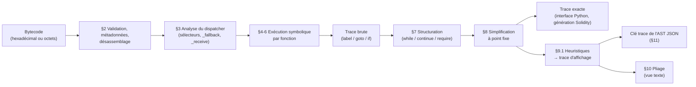

# Pipeline de décompilation : désassemblage, exécution symbolique, structuration et simplification

Ce document (préfixe `DEC`) spécifie les étapes du pipeline qui transforment un bytecode runtime EVM en une trace symbolique structurée par fonction : la validation de l'entrée et la lecture des métadonnées du compilateur, le désassemblage, l'analyse du dispatcher qui découpe le contrat en fonctions, l'exécution symbolique (exploration des chemins, boucles, sémantique des opcodes, lectures d'état datées, budgets et élagage), puis la structuration des boucles et des gardes, la boucle de simplification, les heuristiques réservées à l'affichage et le pliage des chemins destiné à la vue texte. Il se termine par le catalogue de la représentation intermédiaire, qui est aussi le vocabulaire de l'AST JSON exposé et de la trace exacte lue par la génération Solidity.

L'enchaînement global de ces étapes avec le reste du système, leurs budgets configurables et l'isolement des échecs par fonction sont dans [architecture.md](architecture.md) ; la caractérisation des fonctions, l'inférence des paramètres et la reconstruction du stockage, qui consomment la trace produite ici, sont dans [reconstruction-fonctions-stockage.md](reconstruction-fonctions-stockage.md) ; le nommage des fonctions par leurs sélecteurs est dans [resolution-signatures.md](resolution-signatures.md) ; le rendu de la trace en texte et en JSON, ainsi que le format des métadonnées et du résumé du dispatcher, sont dans [sorties.md](sorties.md), sa traduction en Solidity dans [generation-solidity.md](generation-solidity.md). Voir [README.md](../README.md) pour la table des matières du répertoire `docs/`.

Chaque exigence est identifiée par un code FR-DEC-NN. Sauf mention contraire (« DEVRAIT », « PEUT », « NE DOIT PAS »), une exigence est obligatoire (« DOIT »).

## 1. Vue d'ensemble

Le pipeline ne cherche pas à être une émulation de l'EVM : il interprète le bytecode en gardant symboliques toutes les valeurs inconnues (données d'appel, stockage, résultats d'appels), explore les chemins en largeur jusqu'à épuisement ou jusqu'à un budget, puis réécrit la trace obtenue pour la rendre lisible. Les réécritures de la trace exacte préservent les valeurs ; les heuristiques qui ne les préservent pas sont réservées à la trace d'affichage (section 9). Un chemin que le système ne sait pas modéliser s'arrête sur un nœud `undefined` explicite plutôt que de se poursuivre avec un état faux.

- **FR-DEC-01** : Le système DOIT produire, pour chaque fonction, deux formes de sa trace structurée et simplifiée, issues de la même exécution symbolique : la trace exacte, dont toutes les réécritures préservent la sémantique EVM du bytecode (aux seules approximations communes de la section 9.2 près), et la trace d'affichage, qui en diffère par les heuristiques de la section 9.1 et par la présentation des champs de stockage décalés ; la trace d'affichage alimente la vue texte et la clé `trace` de l'AST JSON, la trace exacte est exposée par l'interface Python (voir [architecture.md](architecture.md), section 8) et c'est elle que lit la génération Solidity.
- **FR-DEC-02** : Pour un même bytecode et une même configuration, et hors effet des budgets de temps, le résultat (texte, AST JSON, traces) NE DOIT PAS dépendre de l'aléa de hachage de l'interpréteur (`PYTHONHASHSEED`) : toute énumération de variables, d'accès au stockage ou de masques suit l'ordre de première apparition.

## 2. Entrée, métadonnées et désassemblage

- **FR-DEC-03** : Le système DOIT accepter un bytecode donné soit comme suite d'octets, soit comme chaîne hexadécimale de deux chiffres par octet (chiffres en minuscules ou en majuscules), avec ou sans préfixe `0x` ou `0X`, les blancs qui entourent la chaîne étant ignorés ; une chaîne vide est un code vide, pour lequel aucune fonction n'est décompilée (texte produit dans [sorties.md](sorties.md), section 2.1).
- **FR-DEC-04** : Toute autre entrée DOIT être refusée par une erreur de bytecode invalide, propagée à l'appelant, dont le message donne la raison : caractère non hexadécimal avec sa position (`not hexadecimal: 'z' at position 4`, un blanc interne compris), nombre impair de chiffres (`odd number of hex digits (3): the last byte is incomplete`), ou entrée qui n'est ni une chaîne ni une suite d'octets (`expected a hex string, got int`). Le comportement de la ligne de commande face à cette erreur est spécifié dans [architecture.md](architecture.md), section 7.
- **FR-DEC-05** : Le système DOIT reconnaître la terminaison de métadonnées du compilateur placée à la fin du bytecode — un objet CBOR suivi de sa longueur sur deux octets (solc à partir de 0.4.7, Vyper ; pour Vyper 0.3.10 et suivants, la longueur compte aussi ses deux octets), ou la forme sans longueur de Vyper 0.3.4 — et NE DOIT désassembler et exécuter que le code qui la précède. Le bytecode complet, terminaison comprise, reste le code que lisent `codecopy`, `codesize` et les immédiats des `push`, et il est exposé, avec les métadonnées décodées (compilateur, version ou plage de versions, empreinte), selon [sorties.md](sorties.md).
- **FR-DEC-06** : Le système DOIT associer chaque octet interprété comme instruction soit au mnémonique d'un opcode connu, soit, s'il ne correspond à aucun opcode connu, à une instruction `UNKNOWN` qui conserve la valeur de l'octet comme paramètre.
- **FR-DEC-07** : Le système DOIT reconnaître au minimum le jeu d'opcodes suivant, qui couvre l'EVM jusqu'à la mise à niveau « Cancun » incluse :

  | Famille | Opcodes reconnus |
  |---|---|
  | Arrêt et arithmétique | `stop`, `add`, `mul`, `sub`, `div`, `sdiv`, `mod`, `smod`, `addmod`, `mulmod`, `exp`, `signextend` |
  | Comparaison et bits | `lt`, `gt`, `slt`, `sgt`, `eq`, `iszero`, `and`, `or`, `xor`, `not`, `byte`, `shl`, `shr`, `sar` |
  | Hachage | `sha3` |
  | Environnement | `address`, `balance`, `origin`, `caller`, `callvalue`, `calldataload`, `calldatasize`, `calldatacopy`, `codesize`, `codecopy`, `gasprice`, `extcodesize`, `extcodecopy`, `returndatasize`, `returndatacopy`, `extcodehash` |
  | Bloc | `blockhash`, `coinbase`, `timestamp`, `number`, `prevrandao`, `gaslimit`, `chainid`, `selfbalance`, `basefee`, `blobhash`, `blobbasefee` |
  | Pile, mémoire, stockage, flot | `pop`, `mload`, `mstore`, `mstore8`, `sload`, `sstore`, `jump`, `jumpi`, `pc`, `msize`, `gas`, `jumpdest`, `tload`, `tstore`, `mcopy` |
  | Empilement, duplication, échange | `push0` à `push32`, `dup1` à `dup16`, `swap1` à `swap16` |
  | Journaux | `log0` à `log4` |
  | Système | `create`, `call`, `callcode`, `return`, `delegatecall`, `create2`, `staticcall`, `revert`, `invalid`, `selfdestruct` |

- **FR-DEC-08** : Pour une instruction `pushN`, le système DOIT reconstituer l'immédiat à partir des N octets suivants, lus en gros-boutiste dans le bytecode complet (terminaison de métadonnées comprise) et complétés par des zéros au-delà de sa fin, comme le fait l'EVM, puis positionner l'instruction suivante après ces octets ; `push0` DOIT porter l'immédiat 0 (exemple : le code `61ff` donne `push2` d'immédiat `0xff00`).
- **FR-DEC-09** : Le système DOIT repérer chaque instruction par sa position en octets depuis le début du code et enregistrer les positions des instructions `jumpdest` comme destinations de saut valides ; il DOIT aussi relever, à part, les octets `jumpdest` situés dans la terminaison de métadonnées hors données de `push`, que l'EVM accepterait comme destinations (section 4).
- **FR-DEC-10** : Les immédiats DOIVENT rester des entiers dans la trace ; la présentation sous forme de chaîne des immédiats imprimables relève de la seule vue texte (voir [sorties.md](sorties.md), section 2.4).
- **FR-DEC-11** : Le système DOIT exposer le désassemblage du code qui précède la terminaison de métadonnées sous la forme d'une chaîne par instruction, `<position en hexadécimal>, <mnémonique>, <immédiat en hexadécimal>`, le dernier élément étant vide pour une instruction sans immédiat ; les mnémoniques d'origine (`dup1`…`dup16`, `swap1`…`swap16`, `UNKNOWN`) y sont conservés, une instruction `UNKNOWN` portant en guise d'immédiat la valeur de l'octet non reconnu et `push0` l'immédiat `0x0` (exemple : `0x0, push1, 0x2a`, `0x4, mstore, `).

## 3. Découverte des fonctions : analyse du dispatcher

- **FR-DEC-12** : Le système DOIT effectuer, avant toute décompilation de fonction, une passe légère d'exécution symbolique à partir de la position 0, bornée par le budget de découverte (voir [architecture.md](architecture.md), section 4) et par le budget de nœuds ; dans cette passe, tout saut conditionnel dont la condition compare le sélecteur à une constante (FR-DEC-13) DOIT devenir un point d'entrée de fonction (sélecteur, position cible, pile d'entrée), la branche correspondante n'étant pas explorée plus avant.
- **FR-DEC-13** : Le système DOIT reconnaître comme sélecteur les quatre octets de poids fort du premier mot des données d'appel, quelle que soit leur forme d'extraction (division par 2^224, décalage à droite de 224 bits, éventuellement sous un masque qui garde au moins les 32 bits de poids faible), et comme test de sélecteur, pour une constante K inférieure à 2^32 : l'égalité du sélecteur et de K dans les deux ordres, la négation d'un test reconnu, les différences K − sélecteur et sélecteur − K, et le ou exclusif de K et du sélecteur. Lorsque la condition est vraie pour le sélecteur K, le point d'entrée est la destination du saut, à condition que ce soit une position `jumpdest` ; lorsqu'elle est vraie pour tout autre sélecteur (différence, ou exclusif, négation d'une égalité : dernier cas d'un `switch` compilé par la chaîne via-IR), le point d'entrée est l'instruction qui suit le saut.
- **FR-DEC-14** : Une comparaison d'ordre (ou une égalité) entre le sélecteur et une constante qui n'est pas un test de sélecteur au sens de FR-DEC-13 (recherche dichotomique des grands dispatchers) DOIT être traitée comme un test du dispatcher, ses deux branches étant analysées.
- **FR-DEC-15** : Le système DOIT considérer comme dispatcher le code, à partir de la position 0, qui ne fait que tester le sélecteur, tester la taille des données d'appel, tester la valeur transférée lorsqu'une branche se réduit à un rejet sans données et que l'autre mène à des fonctions (test remonté par solc au-dessus du dispatcher), et écrire en mémoire. Toute autre condition (contrôle d'accès, chemin dépendant d'une valeur) et toute autre instruction (écriture de stockage, appel, journal, boucle, nœud `undefined`) DOIVENT terminer le dispatcher : le sous-arbre qui commence là est une sortie « irrégulière », décompilée d'un seul tenant avec les tests de sélecteur qu'il contient, et le dispatcher est déclaré non régulier.
- **FR-DEC-16** : Le système DOIT classer chaque sortie du dispatcher qui ne mène à aucune fonction selon l'intervalle de taille des données d'appel connu sur son chemin : `empty` (taille nulle), `short` (taille inférieure à 4), `nomatch` (autres cas, après au moins un test de sélecteur ou de taille), `other` (aucun test sur le chemin) ; une branche que contredit l'intervalle connu est du code mort et est ignorée, et une sortie qui se réduit à un test de taille est elle-même scindée selon ce test.
- **FR-DEC-17** : La fonction de repli DOIT être la première sortie `nomatch`, ou à défaut la première sortie non vide ; la fonction de réception DOIT être la première sortie `empty` lorsque son code diffère structurellement de celui de la fonction de repli ; s'il n'existe que des sorties `empty`, la première tient lieu de fonction de repli et il n'y a pas de fonction de réception. Deux sorties ont le même code lorsque leurs traces, mémoire laissée par le dispatcher comprise, sont identiques aux marqueurs, lignes de diagnostic, labels sans variable et numérotation des variables et nœuds de la VM près.
- **FR-DEC-18** : Si une sortie n'a pas de position de départ connue, si une sortie non vide n'exécute pas le code de la fonction de repli, ou si une sortie vide n'exécute ni celui de la fonction de réception ni, à défaut, celui de la fonction de repli, le système DOIT journaliser l'avertissement `Dispatcher exits run different code: the fallback is the whole code.` et décompiler comme fonction de repli tout le code à partir de la position 0, sans fonction de réception ; les fonctions par sélecteur restent décompilées séparément et figurent aussi dans la fonction de repli, qui reprend tout le dispatch.
- **FR-DEC-19** : Un sélecteur atteint par plusieurs chemins avec la même cible DOIT donner un seul point d'entrée ; atteint avec une autre cible, seule la première est retenue et les autres sont signalées comme doublons dans le résumé du dispatcher.
- **FR-DEC-20** : Le système DOIT marquer comme protégé par la valeur transférée tout point d'entrée dont chaque chemin depuis la position 0 traverse un test de la valeur transférée remonté au-dessus du dispatcher (FR-DEC-15), et de même la fonction de repli ou de réception lorsque toutes les sorties qui exécutent son code sont dans ce cas ; une fonction ainsi marquée est non payable (voir [reconstruction-fonctions-stockage.md](reconstruction-fonctions-stockage.md), section 2). Le résumé indique un test remonté pour tout le dispatcher lorsque tous les points d'entrée par sélecteur sont protégés.
- **FR-DEC-21** : Lorsque la passe légère ne contient aucun test de sélecteur reconnu, ou que tous ceux qu'elle contient se trouvent derrière du code qui n'est pas un dispatcher, le système DOIT décompiler tout le code, à partir de la position 0, comme unique fonction de repli ; le résumé du dispatcher ne contient alors aucun sélecteur, indique une fonction de repli « code entier », présente sauf si tout le code se réduit à un rejet sans données, et non régulière lorsque des tests de sélecteur existent à l'intérieur de ce code.
- **FR-DEC-22** : Si la passe de découverte lève une exception, le système DOIT la journaliser (`Loader issue.`) et décompiler tout le code, à partir de la position 0, comme unique fonction de repli.
- **FR-DEC-23** : Le système DOIT identifier chaque fonction par une clé — le sélecteur écrit `0x` suivi de huit chiffres hexadécimaux, `_fallback` pour la fonction de repli, `_receive` pour la fonction de réception — et démarrer son exécution à sa position cible avec la pile d'entrée de son chemin ; lorsque la cible est une position strictement supérieure à 1 occupée par une instruction `jumpdest`, l'exécution démarre à l'octet suivant.
- **FR-DEC-24** : Chaque exécution symbolique d'une fonction DOIT commencer, en tête de sa trace brute, par les écritures mémoire qui décrivent la mémoire à son point de départ : pour une fonction atteinte par le dispatcher, les écritures mémoire du chemin du dispatcher jusqu'à elle, dans l'ordre d'exécution, une écriture constante remplacée plus loin par une écriture constante de la même plage étant omise et les écritures restantes étant triées par adresse lorsqu'elles sont toutes des constantes dans des mots distincts alignés sur 32 octets ; pour une exécution à partir de la position 0, l'écriture de 0 aux adresses 0x40 et 0x60. Pour du code compilé par solc 0.4.22 ou ultérieur, une fonction démarre ainsi avec le pointeur de mémoire libre 0x80 à l'adresse 0x40 et le mot nul à l'adresse 0x60. Ces écritures ne subsistent dans la trace finale que si la simplification ne peut prouver qu'elles sont inutiles.
- **FR-DEC-25** : Le système DOIT exposer le résultat de l'analyse dans un résumé du dispatcher (sélecteurs et cibles, fonction de repli et de réception avec leur nature, test de valeur remonté, régularité, sorties, doublons ; format dans [sorties.md](sorties.md)) et nommer chaque fonction d'après sa clé selon les règles de [resolution-signatures.md](resolution-signatures.md), section 4.1 : `_fallback(?)` pour la fonction de repli, `_receive(?)` pour la fonction de réception, et pour un sélecteur le nom issu de sa signature ou, à défaut, `unknown` suivi de ses huit chiffres hexadécimaux ; le filtre par préfixe de nom de [architecture.md](architecture.md), section 2, s'applique à ces noms.

*Note contextuelle : l'analyse est volontairement conservatrice : un dispatcher précédé d'une condition non reconnue (contrôle d'accès au-dessus du dispatch) ou dont deux sorties atteignent le même code avec des piles différentes donne une fonction de repli « code entier », complète mais plus longue. Les contrats Vyper 0.3.10 et suivants compilés pour le gas ou la taille, qui aiguillent les sélecteurs par une table de sauts (saut vers une valeur lue en mémoire après un `codecopy`), ne sont pas découpés : ils donnent une fonction de repli unique qui contient un nœud `jump to a parameter computed at runtime`.*

## 4. Exploration des chemins

- **FR-DEC-26** : Le système DOIT explorer les chemins d'exécution en largeur d'abord, par nœuds d'exploration dont l'identité est formée de la position de départ, de la hauteur de la pile et de la liste des destinations de saut présentes dans la pile.
- **FR-DEC-27** : Le système DOIT considérer comme destination de saut présente dans la pile toute valeur entière qui est une position `jumpdest` connue ou qui est strictement comprise entre 2 000 et 5 000.
- **FR-DEC-28** : Le système DOIT borner l'exploration à 20 itérations externes de 200 itérations internes ; chaque itération interne exécute tous les nœuds encore inexplorés jusqu'à leur prochain saut ou leur terminaison, puis recherche les boucles (section 5) ; l'exploration s'arrête dès qu'il ne reste plus de nœud inexploré.
- **FR-DEC-29** : Le système DOIT interrompre l'exploration, à l'issue de l'itération interne en cours, dès que le temps écoulé dépasse le budget de l'exécution en cours (budget d'exécution symbolique pour une fonction, budget de découverte pour la passe légère, une valeur nulle signifiant « sans limite ») ou dès que le nombre de nœuds créés dépasse le nombre maximal de nœuds ; ces bornes ne sont donc pas strictes : une itération commencée est toujours menée à son terme.
- **FR-DEC-30** : Une interruption pour budget DOIT journaliser l'avertissement `VM stopped prematurely. Node count <N>, after <S> seconds.` et conserver la trace partielle : chaque nœud resté inexploré y apparaît sous la forme d'un nœud `undefined` portant le message `decompilation didn't finish`, sans que la fonction soit considérée en échec.
- **FR-DEC-31** : Le système DOIT journaliser la progression de l'exploration au plus toutes les 2 secondes, sous la forme `VM progress [<barre>] 
% (<N> nodes)`, où la barre de 20 caractères comporte un `#` par tranche de 5 % (complétée par des `-`) et où P est le rapport entre le nombre de nœuds et le nombre maximal de nœuds, plafonné à 100.
- **FR-DEC-32** : Pour un saut conditionnel, le système DOIT tenter d'évaluer la condition de façon concrète, compte tenu de la condition qui a conduit au nœud courant ; si elle est décidable, seul le chemin correspondant est poursuivi.
- **FR-DEC-33** : Si la condition n'est pas décidable, le système DOIT produire un nœud `if` à deux branches, la branche vraie partant de la destination du saut et la branche fausse de l'instruction suivante.
- **FR-DEC-34** : Le système DOIT appliquer en permanence un élagage dit « protocol-safe », non configurable : dès que le nombre de nœuds dépasse 60 % du nombre maximal de nœuds, la branche fausse de tout nouveau saut conditionnel indécidable est remplacée par un nœud `undefined` portant le message `branch pruned`, et n'est pas explorée.

*Note contextuelle : l'élagage garantit la terminaison de l'exploration sur les gros contrats au prix d'une trace incomplète, mais l'incomplétude est visible : une branche élaguée n'est jamais présentée comme un arrêt normal.*

- **FR-DEC-35** : Un saut vers une destination non entière (calculée à l'exécution) DOIT produire un nœud `undefined` portant le message `jump to a parameter computed at runtime` et la destination ; un saut vers une position entière hors du code désassemblé DOIT produire un nœud `undefined` portant le message `jump into the metadata trailer` et la position lorsque cette position est un octet `jumpdest` de la terminaison de métadonnées (FR-DEC-09), et un nœud `invalid` portant `jumdest` et la position sinon ; un saut vers une instruction qui n'est pas un `jumpdest` DOIT produire un nœud `invalid` portant `jump`.
- **FR-DEC-36** : Un chemin qui atteint, sans saut, une position où le désassemblage n'a pas d'instruction DOIT se terminer par un nœud `undefined` portant le message `execution runs into the metadata trailer` et la position si cette position est dans la terminaison de métadonnées, par un nœud `stop` si elle est au-delà de la fin du bytecode complet (l'EVM s'arrête alors normalement), et par un nœud `invalid` portant `jumpdest` sinon.
- **FR-DEC-37** : Un dépilement sur une pile symbolique vide, ou une duplication ou un échange qui atteint au-delà du fond de la pile, DOIT terminer le chemin par un nœud `undefined` portant le message `stack underflow` et la position de l'instruction, sans faire échouer la fonction : la pile d'entrée connue de l'exécution était incomplète, ce qui ne dit rien du bytecode.
- **FR-DEC-38** : Le système NE DOIT PAS poursuivre un chemin après une instruction qu'il ne sait pas modéliser : un opcode sans traitement DOIT journaliser l'avertissement `unsupported opcode <op> at <position>` et terminer le chemin par un nœud `undefined` portant `unsupported opcode <op>` et la position ; une variation de hauteur de pile différente de celle attendue pour l'opcode DOIT journaliser l'avertissement `opcode <op> at <position>: stack effect <observée>, expected <attendue>` et terminer le chemin par un nœud `undefined` portant `stack effect of <op> not modelled` et la position.

## 5. Détection et repliement des boucles

- **FR-DEC-39** : Le système DOIT reconnaître une boucle lorsqu'un nœud inexploré a la même identité (FR-DEC-26) qu'un de ses ancêtres sur le chemin courant, avec une pile non vide de même hauteur.
- **FR-DEC-40** : Le système DOIT transformer en variables de boucle les positions de la pile dont la valeur diffère entre l'entrée de la boucle et son retour, chaque variable recevant un identifiant entier égal à la hauteur de pile diminuée de la position, augmentée de 1 000 fois une profondeur : la profondeur du nœud dans l'exploration, augmentée tant qu'elle est déjà utilisée par les variables d'un autre label de boucle présent sur le chemin, de sorte que deux boucles imbriquées ou successives n'emploient jamais les mêmes identifiants.
- **FR-DEC-41** : Le système DOIT représenter une boucle dans la trace brute par un nœud `label` portant les valeurs initiales des variables de boucle, et chaque retour en tête de boucle par un nœud `goto` portant les réaffectations de ces variables ; ces nœuds sont ensuite convertis par la structuration (section 7).
- **FR-DEC-42** : Lorsqu'un retour ultérieur vers un label apporte, à une position de pile qui n'est pas encore une variable de boucle, une valeur différente de celle de la pile du label, le système DOIT faire de cette position une variable de boucle supplémentaire et explorer de nouveau le corps de la boucle à partir du label ; les variables d'un label ne faisant que croître, ce processus termine. Un accumulateur que la première itération laisse inchangé (une somme partant de 0) est ainsi suivi comme variable de boucle, et sa valeur après la boucle est celle de la variable.

## 6. Sémantique symbolique des opcodes

### 6.1 Arithmétique, comparaisons et bits

- **FR-DEC-43** : Le système DOIT réduire toute valeur entière de la pile modulo 2^256 et évaluer concrètement, selon la sémantique EVM 256 bits, toute opération arithmétique, de comparaison ou de bits dont tous les opérandes sont concrets (une division, un modulo, un `addmod` ou un `mulmod` par zéro valant 0).
- **FR-DEC-44** : Lorsqu'au moins un opérande est symbolique, le système DOIT produire une expression symbolique normalisée : sommes et produits aplatis avec regroupement des termes semblables et des constantes, soustraction exprimée comme l'addition d'un terme multiplié par −1, conjonction avec une constante de bits contigus convertie en masque, multiplication ou division par une puissance de deux convertie en décalage masqué.
- **FR-DEC-45** : `addmod` et `mulmod` DOIVENT produire chacun leur propre nœud, `addmod` (a, b, m) et `mulmod` (a, b, m), évalués exactement lorsque leurs opérandes sont concrets (par exemple `addmod(2, 3, 7)` vaut 5).
- **FR-DEC-46** : Les décalages et l'extraction d'octet DOIVENT suivre exactement la sémantique EVM :

  | Opcode | Opérandes concrets | Décalage ou indice constant | Décalage ou indice symbolique |
  |---|---|---|---|
  | `shl` (k, x) | valeur exacte | k ≥ 256 : 0 ; sinon masque décalé de k bits vers la gauche | masque décalé de k bits |
  | `shr` (k, x) | valeur exacte | k ≥ 256 : 0 ; k = 0 : x ; sinon `mask_shl(256 − k, k, −k, x)` | nœud `shr` (k, x) |
  | `sar` (k, x) | valeur exacte, signe conservé | nœud `sar` (k, x) | nœud `sar` (k, x) |
  | `byte` (i, x) | valeur exacte | i ≥ 32 : 0 ; sinon `mask_shl(8, 248 − 8i, −(248 − 8i), x)` | nœud `byte` (i, x) |

  Le sélecteur extrait par `shr(224, calldataload(0))` s'écrit ainsi `mask_shl(32, 224, -224, cd(0))`, comme par une division.

*Note contextuelle : un `shl` à décalage symbolique k devient `mask_shl(256, 0, k, x)`, dont le décalage de sortie est lu comme signé (FR-DEC-103) ; pour 2^256 − 256 < k < 2^256, la trace désigne donc x décalé de 2^256 − k bits vers la droite, alors que l'EVM donne 0. La sémantique n'est exacte, pour ce cas, que sur les autres valeurs de k.*

- **FR-DEC-47** : Les opcodes `not` et `iszero` et les comparaisons DOIVENT produire des nœuds symboliques du même nom, simplifiés lorsque c'est possible (double négation, comparaison à zéro, booléens littéraux).

### 6.2 Mémoire, données d'appel et code

- **FR-DEC-48** : `mstore` DOIT produire une écriture de 32 octets à l'adresse dépilée, `mload` une variable temporaire numérotée `_<N>` égale au mot de 32 octets lu, et `mcopy` une écriture de la plage de destination à partir de la plage source lorsque la taille n'est pas nulle.
- **FR-DEC-49** : `mstore8` DOIT produire une écriture mémoire d'un seul octet, de valeur l'octet de poids faible de la valeur dépilée (le nœud `bytes` (1, 0xff) pour la valeur 0xff écrite puis relue).
- **FR-DEC-50** : `calldataload` DOIT produire l'accès `cd(<décalage>)` ; `calldatacopy` et `returndatacopy` de longueur non nulle DOIVENT produire une écriture mémoire de la plage source `call.data(<début>, <longueur>)` ou `ext_call.return_data(<début>, <longueur>)` ; `extcodecopy` DOIT produire une écriture mémoire de la forme `extcodecopy(<adresse>, <plage>)`.
- **FR-DEC-51** : `codecopy` de longueur nulle NE DOIT produire aucune ligne ; avec une position et une longueur concrètes, la longueur ne dépassant pas 65 536 octets, il DOIT produire l'écriture, sur la plage de destination, de l'entier formé des octets copiés du bytecode complet (terminaison de métadonnées comprise), complétés par des zéros au-delà de sa fin ; dans les autres cas, il DOIT produire une écriture de la forme `code.data(<début>, <longueur>)`.
- **FR-DEC-52** : Le chargement du moteur DOIT relever, pour tout le processus, la limite de conversion des entiers en texte décimal de l'interpréteur à au moins 157 828 chiffres (taille d'une copie de code de 65 536 octets), sans jamais l'abaisser, afin que la trace reste convertible en texte et en JSON.
- **FR-DEC-53** : `codesize` DOIT être remplacé par la taille concrète du bytecode complet, terminaison de métadonnées comprise, et `pc` par la position concrète de l'instruction.
- **FR-DEC-54** : `sha3` DOIT produire une variable temporaire numérotée `_<N>` égale au haché de la plage mémoire concernée.
- **FR-DEC-55** : `log0` à `log4` DOIVENT produire un nœud `log` portant la plage mémoire des données puis les sujets (topics) dans l'ordre de dépilement.

### 6.3 Lectures d'état et instantanés

- **FR-DEC-56** : `sload` DOIT produire une lecture de stockage de 256 bits au décalage 0 de l'emplacement dépilé, `sstore` une écriture de stockage de 256 bits au décalage 0, `tload` une lecture de stockage transitoire et `tstore` une écriture de stockage transitoire.
- **FR-DEC-57** : Toute lecture d'un état modifiable DOIT être liée, à l'endroit même de la lecture, à une variable temporaire `_<N>` (instantané) dont la valeur est cette lecture : lecture de stockage, de stockage transitoire, `balance` et `selfbalance`, `extcodesize`, `extcodehash`, `returndatasize`, succès d'un `call` ou d'un `staticcall`, code de retour d'un `callcode`, adresse créée par `create` ou `create2`, résultat d'un précompilé et succès d'un `delegatecall`. Le compteur N est partagé avec les autres variables temporaires. La simplification remplace ensuite la variable par sa valeur partout où aucune ligne intermédiaire ne peut changer cette valeur (FR-DEC-58) ; ailleurs, l'instantané subsiste (exemple : lire l'emplacement 0, y écrire `cd(4)`, puis renvoyer la somme de l'ancienne et de la nouvelle lecture donne `_1 = storage(0)`, l'écriture, puis `return storage(0) + _1`).
- **FR-DEC-58** : Le système DOIT déterminer les états qu'une ligne peut changer selon la table suivante, une boucle changeant ce que change son corps et une alternative ce que changent ses branches :

  | Ligne | États qu'elle peut changer |
  |---|---|
  | `store` | stockage (seulement les champs qui peuvent coïncider avec ceux lus, FR-DEC-59) |
  | `tstore` | stockage transitoire |
  | `staticcall`, `precompiled` | résultats du dernier appel (succès, données et taille de retour) |
  | `call`, `callcode`, `delegatecall`, `create`, `create2`, `selfdestruct` | tous : stockage, stockage transitoire, soldes et code des comptes, résultats du dernier appel |
  | autres lignes | aucun |

  Une expression dépend du stockage par ses lectures de stockage, du stockage transitoire par `tload`, des soldes par `balance`, du code des comptes par `extcodesize`, `extcodehash` et `extcodecopy`, et des résultats d'appel par les atomes et variables de résultat (FR-DEC-105) et les tranches de données de retour.
- **FR-DEC-59** : Une écriture de stockage NE DOIT être considérée comme changeant une lecture que si leurs emplacements peuvent coïncider et leurs champs se chevaucher. Deux emplacements sont tenus pour différents lorsqu'ils sont deux constantes différentes, une même base symbolique augmentée de deux constantes différentes, un emplacement haché (mapping, données d'un tableau dynamique) éventuellement augmenté d'une constante et un emplacement constant, un emplacement haché augmenté d'un index calculé et un emplacement constant inférieur à 2^64, ou deux hachés de préimages distinctes.

*Note contextuelle : ces règles reprennent les hypothèses sur lesquelles repose la disposition du stockage Solidity (keccak sans collision, données hachées loin des emplacements déclarés). Un code assembleur qui écrirait keccak(k) augmenté d'un très grand index sur un petit emplacement, ou un contrat antérieur à Solidity 0.6 dont la longueur d'un tableau aurait été corrompue, serait mal modélisé.*

- **FR-DEC-60** : Les opcodes d'environnement et de bloc sans opérande DOIVENT produire des atomes symboliques portant leur nom (`callvalue`, `caller`, `address`, `number`, `gas`, `origin`, `timestamp`, `chainid`, `prevrandao`, `gasprice`, `coinbase`, `gaslimit`, `calldatasize`, `basefee`, `blobbasefee`), `returndatasize` un instantané de l'atome `returndatasize` ; `selfbalance` DOIT produire un instantané du solde de `address` ; `balance`, `extcodesize` et `extcodehash` DOIVENT produire un instantané d'un nœud de même nom portant leur opérande (pour `balance`, une adresse masquée sur 160 bits étant débarrassée de son masque, une adresse constante étant acceptée) ; `blockhash` et `blobhash` DOIVENT produire un nœud de même nom portant leur opérande ; `msize` DOIT produire une variable temporaire numérotée.

### 6.4 Appels et créations

- **FR-DEC-61** : `call` et `staticcall` vers une adresse qui n'est pas un précompilé (FR-DEC-66) DOIVENT produire un nœud portant le gas, l'adresse, la valeur transférée (0 pour `staticcall`), la valeur `None` à la place historique du nom de fonction, puis les données d'appel entières, sous la forme d'une suite d'octets de leur longueur exacte (`None` lorsqu'elles sont vides), dont les quatre premiers octets sont le sélecteur appelé ; le résultat empilé est un instantané de l'atome `ext_call.success`.
- **FR-DEC-62** : Après un `call`, un `staticcall`, un `delegatecall` ou un `callcode` dont la longueur de la zone de retour L peut être non nulle, le système DOIT écrire dans la zone de retour [P, P + L) exactement min(L, `returndatasize`) octets des données de retour de cet appel, le reste de la zone gardant sa valeur : `setmem(range(P, min(L, returndatasize)), <données de retour>(…, min(L, returndatasize)))`. La simplification DOIT déplacer cette copie vers le bas de la trace, au-delà des lignes qui ne lisent pas la mémoire qu'elle peut écrire et ne font pas d'autre appel, jusque dans les branches des alternatives, et l'écrire comme copie de toute la zone, `setmem(range(P, L), <données de retour>(…, L))`, dans une branche dont la condition prouve que `returndatasize` vaut au moins L (contrôle émis par solc 0.4.22 et suivants pour les appels de haut niveau) ; ailleurs, la copie exacte subsiste.
- **FR-DEC-63** : `delegatecall` DOIT produire un nœud sans valeur transférée portant le gas, l'adresse, `None` puis les données d'appel entières (FR-DEC-61), empiler un instantané de la variable de succès `delegatecall_<N>.success`, où N provient du compteur partagé avec les variables temporaires, et écrire la zone de retour selon FR-DEC-62 depuis `delegate.return_data`, dont le premier champ est l'adresse appelée.
- **FR-DEC-64** : `callcode` DOIT produire un nœud portant le gas, l'adresse, la valeur transférée, `None` puis les données d'appel entières (FR-DEC-61), empiler un instantané de l'atome `callcode.return_code` et écrire la zone de retour selon FR-DEC-62 depuis `callcode.return_data`.
- **FR-DEC-65** : `create` et `create2` DOIVENT produire des nœuds portant la valeur, le code (la plage mémoire du code, `None` lorsqu'elle est vide) et, pour `create2`, le sel, et empiler respectivement un instantané de l'atome `create.new_address` ou `create2.new_address`.
- **FR-DEC-66** : Un `call` ou un `staticcall` vers un précompilé d'adresse concrète DOIT être traité ainsi :

  | Adresse | Représentation | Résultat empilé |
  |---|---|---|
  | 4 (identité) | copie mémoire de n = min(longueur des arguments, longueur de la zone de retour) octets des arguments vers la zone de retour, aucune ligne si n = 0 ; nœud `undefined` portant `identity precompile: copied length unknown` et la position lorsque ce minimum n'est pas décidable | `memcopy.success` |
  | 1 | nœud précompilé `erecover`, variable de résultat `signer` | instantané de `erecover.result` |
  | 2 | nœud précompilé `sha256hash`, variable de résultat `hash` | instantané de `sha256hash.result` |
  | 3 | nœud précompilé `ripemd160hash`, variable de résultat `hash` | instantané de `ripemd160hash.result` |
  | 5 | nœud précompilé `bigModExp`, variable de résultat `mod_exp` | instantané de `bigModExp.result` |
  | 6 | nœud précompilé `bn256Add`, variable de résultat `bn_add` | instantané de `bn256Add.result` |
  | 7 | nœud précompilé `bn256ScalarMul`, variable de résultat `bn_scalar_mul` | instantané de `bn256ScalarMul.result` |
  | 8 | nœud précompilé `bn256Pairing`, variable de résultat `bn_pairing` | instantané de `bn256Pairing.result` |

  Pour les adresses 1 à 3 et 5 à 8, la zone de retour reçoit la variable de résultat. Tout autre appel, y compris vers les précompilés d'adresse supérieure ou égale à 9, DOIT être traité comme un appel ordinaire (FR-DEC-61).

*Note contextuelle : la sortie d'un précompilé est écrite comme un mot entier dans la zone de retour, alors que l'EVM n'écrit que min(L, taille de la sortie) octets et qu'un `ecrecover` invalide n'écrit rien ; le précompilé d'identité ne produit pas de ligne d'appel et ne compte donc pas comme dernier appel pour les atomes de résultat ; la valeur transférée par un `call` vers un précompilé n'est pas modélisée (solc n'en émet pas) ; un `returndatasize` lu avant tout appel reste l'atome (il vaut 0 dans l'EVM).*

### 6.5 Terminaisons et mode diagnostic

- **FR-DEC-67** : Les instructions terminales DOIVENT produire les nœuds suivants : `return` et `revert` portant `None` lorsque la taille des données est nulle et la plage mémoire des données sinon (`return` portant 0 désigne donc un mot nul de 32 octets, jamais une absence de données) ; `stop` ; `selfdestruct` portant l'adresse bénéficiaire ; `invalid` pour l'opcode `invalid` comme pour toute instruction `UNKNOWN`.
- **FR-DEC-68** : En mode diagnostic `--verbose`, le système DOIT insérer dans la trace, avant chaque instruction qui n'est ni un saut ni une instruction terminale, l'état de la pile, une ligne vide et la ligne de désassemblage (position, mnémonique et, le cas échéant, immédiat) sous forme de lignes de texte ; ces lignes subsistent dans la trace structurée, donc dans l'AST et dans le texte (affichées comme commentaires), et peuvent modifier la caractérisation de la fonction. Avec `--explain`, ces lignes sont insérées aussi avant les sauts et les instructions terminales, puis retirées de la trace avant la structuration.

## 7. Structuration des boucles et des gardes

- **FR-DEC-69** : Pour chaque nœud `label`, le système DOIT parcourir la suite de la trace jusqu'au premier `if` qui n'est pas une garde de rejet (FR-DEC-70) ; si une seule des deux branches de ce `if` contient un `goto` vers ce même label, il DOIT produire un nœud `while` portant la condition de continuation (la condition du `if` ou sa négation), le corps (la branche qui boucle), un identifiant de boucle et les valeurs initiales des variables, suivi de la branche de sortie ; les instructions rencontrées avant ce `if` sont placées avant la boucle, les variables de boucle y étant remplacées par leurs valeurs initiales, et recopiées dans le corps avant chaque retour en tête de boucle, les variables y étant remplacées simultanément par leurs réaffectations (une réaffectation qui nomme une autre variable de boucle en désigne l'ancienne valeur).
- **FR-DEC-70** : Dans ce parcours préalable, tout `if` dont une branche se réduit à une seule instruction `revert` (avec ou sans données) ou `invalid` DOIT être converti en nœud `require` portant la condition qui évite cette branche et cette instruction elle-même, l'exploration se poursuivant dans l'autre branche ; une branche de plusieurs lignes (données de rejet écrites en mémoire avant le `revert`) et une branche `return`, même sans données, ne sont jamais converties.
- **FR-DEC-71** : Le système DOIT convertir chaque nœud `goto` restant en nœud `continue` portant l'identifiant de la boucle et les réaffectations des variables, qui sont des affectations simultanées.
- **FR-DEC-72** : Un label pour lequel aucune boucle n'est identifiable (aucun `if` discriminant, ou `goto` présent dans les deux branches ou dans aucune) DOIT être conservé tel quel dans la trace, et reste donc visible dans les sorties (affichage dans [sorties.md](sorties.md), section 2.3).
- **FR-DEC-73** : Le système DOIT supprimer de la trace les marqueurs `jumpdest` résiduels avant la simplification.
- **FR-DEC-74** : La structuration NE DOIT PAS avoir de borne de temps propre : elle DOIT rester couverte par le budget par fonction (voir [architecture.md](architecture.md), section 4), la simplification qui la suit étant bornée par sa propre limite de temps (FR-DEC-76).

*Note contextuelle : certaines boucles restent des labels résiduels suivis de `continue` placés hors de tout `while` : celles dont le premier `if` discriminant contient un retour en tête dans ses deux branches (un `if`/`else` au début du corps, par exemple), et les points de jonction que la chaîne via-IR atteint deux fois avec la même pile.*

## 8. Boucle de simplification à point fixe

- **FR-DEC-75** : Le système DOIT répéter la séquence de passes de simplification tant que la trace change, dans la limite de 40 passes, ramenée à 20 lorsque la trace compte plus de 2 000 lignes de premier niveau.
- **FR-DEC-76** : La simplification d'une fonction DOIT s'arrêter à sa limite de temps, qui est la plus proche de trois échéances : le début de la simplification augmenté du budget de simplification, le début de la décompilation de la fonction augmenté de 75 % du budget par fonction (voir [architecture.md](architecture.md), section 4 : 600 et 720 secondes par défaut, soit 540 secondes pour la seconde échéance), et la limite d'une simplification englobante ; un budget de simplification nul, ou un budget par fonction nul ou négatif, n'impose aucune échéance. La limite DOIT être vérifiée avant chaque passe et à l'intérieur des réécritures dont le coût croît avec le carré de la longueur de la trace (nettoyage de la mémoire, propagation des écritures mémoire, élimination des variables), qui laissent alors le reste de leur trace inchangé ; la trace obtenue DOIT rester exacte, simplement moins simplifiée, et le post-traitement final (FR-DEC-88) s'y applique encore, sans ses nettoyages de la mémoire. Le système DOIT alors journaliser l'avertissement `simplification stopped at its time limit (<S> s): the trace is exact but not fully simplified`, S étant la durée de la limite en secondes.
- **FR-DEC-77** : Une fonction dont la simplification s'est arrêtée à sa limite de temps DOIT être marquée comme telle (`time_limited`, représentation dans l'AST JSON et dans le texte selon [sorties.md](sorties.md)) et le système DOIT journaliser l'avertissement `<nom>: simplification stopped at its time limit (PANORAMIX_WHILES_TIMEOUT, PANORAMIX_FUNCTION_TIMEOUT): the code is exact but not fully simplified` ; une telle fonction n'est pas en échec.
- **FR-DEC-78** : Le système DOIT journaliser la progression toutes les 5 passes sous la forme `Simplify progress 
% (pass <k>/<max>)`.
- **FR-DEC-79** : Chaque passe DOIT enchaîner, dans cet ordre : simplification des expressions ; élimination des variables ; nettoyage de la mémoire ; résolution des zones de retour des appels (FR-DEC-62) ; découpage des écritures mémoire et des écritures de stockage en champs ; nouvelle élimination des variables ; réduction des instantanés de stockage aux champs utilisés (FR-DEC-84) ; nouvelle simplification des expressions ; nettoyage d'expressions (suppression des multiplications par 1, booléens littéraux ramenés aux entiers 1 et 0, masques redondants sur une lecture de stockage, sur `caller` ou sur une chaîne littérale retirés) ; remplacement de `msize` ; reconnaissance des longueurs de chaînes en stockage ; nettoyage des conditions ; conversion des boucles d'écriture mémoire ; propagation des index de stockage hors des boucles.
- **FR-DEC-80** : La simplification des expressions DOIT normaliser les expressions (sommes, produits, masques imbriqués, égalités dont les deux membres partagent des termes, modulo par une puissance de deux converti en masque), sans jamais simplifier une comparaison d'ordre en retirant des termes communs (le débordement modulo 2^256 la rendrait fausse) ni changer la largeur en octets d'une suite d'octets (FR-DEC-102), et mettre en cache ses résultats pour la durée du processus.
- **FR-DEC-81** : L'élimination des variables DOIT remplacer chaque variable temporaire par sa valeur dans la suite de la trace jusqu'à la première ligne qui peut changer cette valeur (états de FR-DEC-58, écriture qui peut recouvrir une mémoire lue, nouvelle affectation de la variable), puis supprimer l'affectation lorsque la variable n'est plus utilisée ; elle NE DOIT PAS remplacer une variable dont la valeur, écrite en mémoire, est relue après une ligne qui la change, ni propager une valeur dans la condition et le corps d'une boucle qui peut la changer ou qui affecte de nouveau la variable avant chaque retour en tête ; après une boucle, les variables de boucle ne sont remplacées que par leurs valeurs finales exactes (FR-DEC-87).
- **FR-DEC-82** : Le nettoyage de la mémoire DOIT remplacer les lectures d'une zone mémoire par la valeur connue qui y a été écrite tant qu'aucune écriture intermédiaire ne peut la recouvrir (un recouvrement indécidable arrêtant le remplacement), supprimer les écritures devenues inutiles et l'écriture d'une plage par sa propre valeur ; il DOIT être sauté, avec un message de niveau DEBUG, lorsque la trace compte plus de 2 000 lignes de premier niveau.
- **FR-DEC-83** : Le découpage DOIT scinder une écriture mémoire d'au plus 32 octets dont la valeur combine des champs alignés sur l'octet en une écriture par champ, et une écriture de stockage de 256 bits dont la valeur combine des champs disjoints (termes d'un `or`, ou masque gardant plusieurs plages d'octets entiers du mot) en une écriture par champ écrit : un terme constant nul ne donne aucune écriture, l'écriture d'un champ par sa propre valeur courante est omise et une valeur booléenne ou étroite n'est écrite que sur ses propres bits. Les écritures d'un même mot DOIVENT être ordonnées de sorte qu'une écriture dont la valeur lit des bits de l'emplacement précède celles qui écrivent ces bits ; lorsqu'aucun ordre ne convient (échange ou rotation de champs) ou que l'emplacement dépend lui-même des bits écrits, et lorsqu'un champ déborde du mot (avertissement `unusual store`), l'écriture reste entière. L'écriture d'un emplacement par un seul de ses propres champs, les autres bits étant mis à zéro, DOIT devenir la mise à zéro des autres parties de l'emplacement.
- **FR-DEC-84** : Un instantané d'un mot de stockage dont chaque utilisation ne prend qu'un champ DOIT être réduit à la lecture de ce champ ; si plusieurs champs sont utilisés, il DOIT être remplacé par un instantané par champ, nommé `_<N>_<décalage>_<taille>`, tous placés à l'endroit de la lecture.
- **FR-DEC-85** : Le nettoyage des conditions DOIT supprimer tout `if` dont la condition s'évalue concrètement (en ne gardant que la branche retenue), remplacer la condition d'un `while` toujours vraie par la constante booléenne vraie (ramenée ensuite à l'entier 1 par le nettoyage d'expressions de FR-DEC-79), et supprimer entièrement un `while` dont la condition est toujours fausse.
- **FR-DEC-86** : Le remplacement de `msize` DOIT substituer à cet atome la borne supérieure courante des zones mémoire écrites.
- **FR-DEC-87** : Une boucle dont le corps se réduit à l'écriture d'un mot mémoire suivie d'un `continue`, avec un pas de ±32 octets et un nombre d'itérations calculable, DOIT être remplacée par une écriture unique de toute la plage (valeur nulle ou copie d'une autre plage mémoire) suivie des valeurs finales des variables ; une boucle recopiant des mots de stockage consécutifs vers la mémoire DOIT de même être remplacée par une écriture unique de plage. Après toute autre boucle, une variable de boucle NE DOIT être remplacée par une forme close que si celle-ci est exacte : compteur comparé tel quel à une borne que la boucle ne change pas, partant de 0 vers le haut ou d'au-dessus de la borne vers le bas, chaque variable progressant d'une constante par itération ; sinon, la variable après le `while` désigne sa valeur de sortie. La propagation des index de stockage DOIT exprimer un index de boucle qui parcourt les données d'un tableau en stockage (keccak(emplacement) + i) relativement à keccak(emplacement) dans la boucle et lui rendre sa valeur absolue après la boucle, et uniquement lorsque cela préserve la sémantique (haché identique à chaque itération, mises à jour additives, aucune autre affectation, aucun `continue` vers une boucle extérieure).
- **FR-DEC-88** : Après la boucle de simplification, le système DOIT appliquer un post-traitement final, dans cet ordre : extraction de la partie commune des maxima (`max(2 + x, 3 + y)` devient `2 + max(x, 1 + y)`) ; reconnaissance des tableaux dans les données ; puis, pour la trace exacte, trois nettoyages de la mémoire, deux nettoyages des conditions, le renommage lisible des variables et le nettoyage d'expressions de FR-DEC-79. La trace d'affichage DOIT recevoir en plus, avant ce même enchaînement, les heuristiques de la section 9.1, et, après, la présentation des champs de stockage d'au moins un octet décalés vers la gauche comme le champ lui-même ; lorsque les heuristiques ne changent rien, elle se confond avec la trace exacte à cette présentation près.
- **FR-DEC-89** : Le renommage lisible DOIT attribuer au compteur d'une boucle l'index 0 (ou le premier index libre à partir de 0) et aux autres variables de boucle les index libres suivants à partir de 1 (affichés respectivement `idx`, `s`, `t`, `u`, `v`, `w`, `x`, `y`, `z`, `a` à `h`, puis `var<N>` au-delà), et introduire une affectation de la variable `_msize` lorsqu'une écriture mémoire a pour adresse une somme comportant un maximum, ce maximum étant alors remplacé par `_msize` dans la suite de la trace.
- **FR-DEC-90** : Lors de ce renommage, un `if` dont la branche fausse se réduit à un `revert` DOIT être réécrit avec la condition inversée et les branches échangées, de sorte que le rejet figure dans la branche vraie.

## 9. Heuristiques et approximations

### 9.1 Heuristiques réservées à la trace d'affichage

Certaines réécritures sont inexactes d'un point de vue mathématique, mais rendent lisibles un grand nombre de contrats compilés par les anciennes versions de solc et, en pratique, ne changent pas l'interprétation humaine du code. Elles ne sont appliquées qu'à la trace d'affichage.

- **FR-DEC-91** : Le système DOIT appliquer les heuristiques de cette section sans les signaler, et uniquement à la trace d'affichage : un lecteur DOIT considérer le pseudo-code et la clé `trace` de l'AST comme une interprétation, et la trace exacte NE DOIT contenir aucune de ces réécritures.
- **FR-DEC-92** : Un `if` testant la nullité d'une longueur modulo 32 (ou d'une longueur de chaîne en stockage modulo 32) dont la branche vraie contient un tableau de cette longueur DOIT être remplacé par sa seule branche vraie.
- **FR-DEC-93** : Pour l'écriture d'une chaîne en stockage, les cas « chaîne vide » et « chaîne de moins de 31 octets » DOIVENT être masqués au profit du seul cas « chaîne d'au moins 32 octets » ; pour la lecture d'une chaîne en stockage, seule la branche « chaîne longue » DOIT être conservée.
- **FR-DEC-94** : Une écriture de longueur en stockage suivie de deux boucles, la première recopiant des mots mémoire vers le stockage, DOIT être remplacée, avec ces deux boucles, par une écriture unique d'un tableau en stockage.

*Note contextuelle : la règle de FR-DEC-92 compare, dans le code hérité, la branche vraie avec elle-même ; elle s'applique donc dès que la branche vraie contient un tableau de la longueur testée, sans vérifier la branche fausse.*

### 9.2 Approximation commune aux deux traces

- **FR-DEC-95** : Le système DOIT décider du signe d'une somme symbolique (comparaison de décalages mémoire, de bornes de boucle ou de longueurs) en substituant à ses variables toutes les combinaisons des valeurs 2^230 − 1 et 0 (la valeur 96 au lieu de 0 pour le mot mémoire situé à l'adresse 64, la valeur 6 pour la taille des données d'appel), chaque combinaison remplaçant toutes les variables à la fois ; la somme est jugée positive ou nulle si toutes les variantes le sont, négative si toutes sont négatives, et indécidable sinon ou si une variante n'est pas concrète.

*Note contextuelle : cette décision est une heuristique, qui s'applique aussi à la trace exacte : une somme de champs masqués d'une même valeur peut en théorie la mettre en défaut (elle peut être nulle pour les deux valeurs essayées et négative pour une autre) ; aucune erreur de ce type n'est connue.*

## 10. Pliage des chemins pour l'affichage

- **FR-DEC-96** : Pour la vue texte, le système DOIT déplier la trace d'affichage de chaque fonction en chemins linéaires (chaque `if` devenant une assertion de sa condition ou de sa négation), puis fusionner les préfixes et suffixes communs de ces chemins pour reconstruire des `if`/`else` aussi concis que possible, en produisant un `if` sans `else` lorsque la branche vraie se termine par une instruction terminale.
- **FR-DEC-97** : Le système DOIT considérer comme terminales les instructions `return`, `stop`, `selfdestruct`, `invalid`, `revert`, `continue` et `undefined`.
- **FR-DEC-98** : Le pliage DOIT être utilisé uniquement pour la vue texte : la clé `trace` de l'AST JSON porte la trace d'affichage non pliée, et la trace exacte, non pliée elle aussi, n'est exposée que par l'interface Python.
- **FR-DEC-99** : Un échec du pliage DOIT être journalisé (`folder failed in a function.`) et la trace d'origine conservée pour l'affichage de la fonction concernée.

## 11. Représentation intermédiaire (référence)

La trace structurée est une liste d'instructions ; chaque instruction et chaque expression est un n-uplet dont le premier élément est un opérateur, sérialisé en liste dans l'AST JSON. Ce catalogue est la référence commune de [sorties.md](sorties.md) et de [generation-solidity.md](generation-solidity.md) ; il vaut pour la trace exacte comme pour la trace d'affichage.

- **FR-DEC-100** : Le système DOIT exprimer les instructions de la trace structurée au moyen des formes suivantes :

  | Forme | Signification |
  |---|---|
  | `if`, condition, branche vraie, branche fausse | alternative |
  | `while`, condition, corps, identifiant, affectations initiales | boucle |
  | `continue`, identifiant, réaffectations | retour en tête de boucle (affectations simultanées) |
  | `require`, condition, ligne | garde issue de la structuration (section 7) : la ligne, `revert` avec ses données ou `invalid`, s'exécute lorsque la condition est fausse |
  | `label`, nœud, affectations | résidu de boucle non convertie (FR-DEC-72) |
  | `setvar`, identifiant, valeur | affectation de variable (temporaire ou instantané `_<N>`, instantané de champ `_<N>_<décalage>_<taille>`, variable de boucle entière, `_msize`) |
  | `setmem`, plage, valeur | écriture mémoire |
  | `store`, taille, décalage, emplacement, valeur | écriture de stockage (champ de `taille` bits au `décalage` en bits) |
  | `tstore`, emplacement, valeur | écriture de stockage transitoire |
  | `log`, données, sujets… | émission d'un journal d'événement |
  | `call` / `staticcall`, gas, adresse, valeur, `None`, données d'appel | appel externe (FR-DEC-61) |
  | `delegatecall`, gas, adresse, `None`, données d'appel | appel délégué |
  | `callcode`, gas, adresse, valeur, `None`, données d'appel | appel hérité `callcode` |
  | `create`, valeur, code ; `create2`, valeur, code, sel | création de contrat |
  | `precompiled`, variable, nom, arguments | appel d'un précompilé (FR-DEC-66) |
  | `return` / `revert`, données | terminaison avec données (`None` = aucune donnée, 0 = un mot nul) |
  | `stop` ; `invalid`… ; `selfdestruct`, adresse | autres terminaisons |
  | `undefined`, message, position ou expression | chemin interrompu ou non modélisé (table ci-dessous) |
  | chaîne de caractères | ligne de commentaire (mode `--verbose`) |

  Messages des nœuds `undefined` :

  | Message | Cause |
  |---|---|
  | `decompilation didn't finish` | budget d'exploration atteint (FR-DEC-30) |
  | `branch pruned` | élagage « protocol-safe » (FR-DEC-34) |
  | `jump to a parameter computed at runtime` | saut vers une destination symbolique (FR-DEC-35) |
  | `jump into the metadata trailer` | saut vers un `jumpdest` de la terminaison de métadonnées (FR-DEC-35) |
  | `execution runs into the metadata trailer` | exécution qui entre dans la terminaison de métadonnées (FR-DEC-36) |
  | `stack underflow` | pile d'entrée insuffisante (FR-DEC-37) |
  | `unsupported opcode <op>`, `stack effect of <op> not modelled` | instruction non modélisée (FR-DEC-38) |
  | `identity precompile: copied length unknown` | longueur copiée par le précompilé d'identité indécidable (FR-DEC-66) |

- **FR-DEC-101** : Le système DOIT exprimer les expressions au moyen des formes suivantes : entiers (FR-DEC-107) ; chaînes (atomes symboliques) ; `None` (suite d'octets vide) ; `mem` (plage) pour une lecture mémoire ; `var` (identifiant) pour une variable ; `cd` (décalage) pour un mot des données d'appel ; `call.data`, `ext_call.return_data`, `callcode.return_data`, `code.data` (début, longueur) et `delegate.return_data` (adresse appelée, longueur) pour des tranches d'octets ; `extcodecopy` (adresse, plage) pour du code d'un autre compte ; `bytes` (n, x) et `data` (parties…) pour les suites d'octets (FR-DEC-102) ; `arr` (longueur, contenu…) pour un tableau dynamique ; `storage` (taille, décalage, emplacement) pour une lecture de stockage avant reconstruction, puis `stor` après reconstruction (formes d'emplacement dans [reconstruction-fonctions-stockage.md](reconstruction-fonctions-stockage.md), section 4) ; `mask_shl` (FR-DEC-103) ; les opérateurs `add`, `mul`, `div`, `sdiv`, `mod`, `smod`, `exp`, `signextend`, `addmod`, `mulmod`, `and`, `or`, `xor`, `not`, `iszero`, `bool`, `eq`, `lt`, `gt`, `le`, `ge`, `slt`, `sgt`, `sle`, `sge`, `max`, `min`, `shr`, `sar`, `byte` ; `sha3`, `balance`, `blockhash`, `blobhash`, `extcodesize`, `extcodehash`, `tload` ; `param` (nom) pour un paramètre nommé dans la trace d'affichage.
- **FR-DEC-102** : Toute suite d'octets DOIT porter une largeur exacte : un mot (toute expression qui n'est pas une suite d'octets) a 32 octets ; `mem` d'une plage de n octets et les tranches de longueur n ont n octets ; `bytes` (n, x) désigne les n octets gros-boutistes de x modulo 2^(8n), complétés de zéros à gauche au-delà de 32 ; `data` (parties…) désigne la concaténation de ses parties, de largeur la somme de leurs largeurs. Les parties vides sont supprimées et les morceaux adjacents d'un même mot fusionnés ; une concaténation réduite à une partie est cette partie, et sans partie elle vaut `None` ; une écriture mémoire d'une suite entièrement nulle a pour valeur 0. Placée dans une expression (sous un masque, par exemple), une suite d'octets désigne l'entier gros-boutiste formé de tous ses octets. Exemples : le rejet `require(a > 3, "short reason")` a pour données `data(bytes(4, 0x08c379a0), 32, 12, <texte>)`, un rejet `Panic(0x11)` `data(bytes(4, 0x4e487b71), 17)`, et les données d'appel d'un appel d'un seul octet 0x61 `bytes(1, 0x61)`.
- **FR-DEC-103** : Le nœud `mask_shl` DOIT porter quatre paramètres — taille, décalage et décalage de sortie, exprimés en bits, puis la valeur — et désigner le résultat obtenu en conservant les `taille` bits de la valeur situés à partir du bit `décalage` (les autres bits étant mis à zéro, sans déplacement), puis en décalant ce résultat de `décalage de sortie` bits vers la gauche (vers la droite si ce paramètre est négatif) ; `mask_shl(256, 0, 0, v)` est identique à `v`, `mask_shl(255, 0, 1, v)` vaut `2 × v` et `mask_shl(255, 1, -1, v)` vaut `v / 2` ; une taille calculée à l'exécution est signée, et une taille négative ou nulle ne conserve aucun bit.
- **FR-DEC-104** : Une plage mémoire DOIT être exprimée par la forme `range` (début, longueur), en octets ; la longueur peut être symbolique (par exemple `min(L, returndatasize)` pour une zone de retour, FR-DEC-62).
- **FR-DEC-105** : Les atomes nommés DOIVENT désigner les valeurs d'environnement de FR-DEC-60 ainsi que les résultats d'opérations : `ext_call.success`, `memcopy.success`, `callcode.return_code`, `create.new_address`, `create2.new_address`, `returndatasize`, `<précompilé>.result` ; les variables `delegatecall_<N>.success` et les variables de résultat des précompilés (`signer`, `hash`, `mod_exp`, `bn_add`, `bn_scalar_mul`, `bn_pairing`) désignent elles aussi des résultats d'appel.
- **FR-DEC-106** : Un atome, une variable de résultat ou un nœud qui lit un état modifiable DOIT désigner sa valeur à la ligne où il apparaît, les opérandes d'une ligne étant lus avant l'effet de cette ligne (valeur écrite, données d'un appel, affectations initiales d'un `while`) ; les atomes, variables et tranches de résultat d'appel désignent le résultat du dernier appel de leur sorte avant cette ligne sur le chemin (un appel statique, un appel, un appel délégué, un `callcode`, une création et un précompilé remplaçant chacun les données de retour) ; une valeur lue avant un changement et utilisée après reste liée à son instantané (FR-DEC-57).
- **FR-DEC-107** : Les entiers de la trace DOIVENT désigner des mots EVM modulo 2^256 : une constante dont le bit de poids fort vaut 1 est écrite comme entier négatif (son complément à deux) lorsque cette valeur signée est supérieure à −8^22, et comme entier non signé sinon (adresse ou masque probable) ; un entier plus large qu'un mot ne provient que d'une copie de code (FR-DEC-51) ou d'une suite d'octets de plus de 32 octets.
- **FR-DEC-108** : Lors de la sérialisation dans l'AST JSON, les n-uplets DOIVENT devenir des listes, `None` la valeur `null`, et les nœuds d'exploration résiduels (`label`) DOIVENT être remplacés par leur représentation textuelle `Node((<position>, <hauteur>, (<destinations>)))`, forme que portent déjà les identifiants de `while` et de `continue`.

---

Navigation : [architecture.md](architecture.md) · [reconstruction-fonctions-stockage.md](reconstruction-fonctions-stockage.md) · [resolution-signatures.md](resolution-signatures.md) · [generation-solidity.md](generation-solidity.md) · [sorties.md](sorties.md) · [integration.md](integration.md) · [README.md](../README.md)
